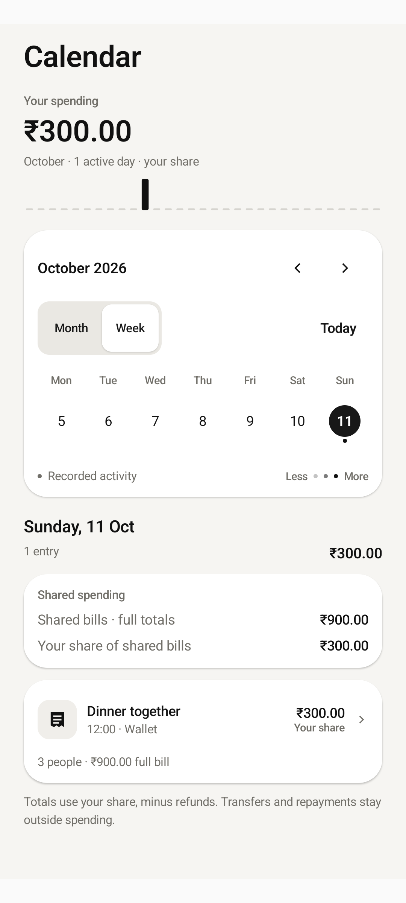
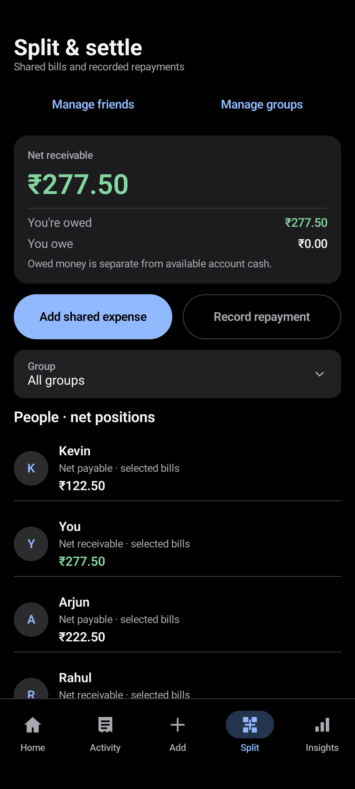

<p align="center">
  
</p>

# Tally

**Know what you can spend. Know who owes you.**

Tally is a native Android app for tracking personal spending, spendable Wallet and GPay balances, and shared bills with friends. It maintains all records strictly on your device, performing every financial calculation in integer paise so bill splits, repayments, and multi-source ledger entries reconcile with zero rounding drift.

Built with **Kotlin 2.2 · Jetpack Compose · Room 2.8 · Dagger Hilt · Google ML Kit**. Supports **Android 8.0+ (API 26+)**, with **INR (₹)** as the core currency. The Android application package is labelled **Smart Expense Tracker**.

> **Development snapshot · October 2026.** This repository contains the complete Android application source, Room database migrations, and test suites. Automated verification passes 124 JVM unit tests, debug APK assembly, and Android lint with zero errors.

---

## What You Can Do

| Capability | Features |
| :--- | :--- |
| **Wallet & GPay** | Track separate Wallet and GPay accounts alongside a combined spendable total. Record opening balances, top-ups, adjustments, transfers, and optional scheduled GPay monthly funding resets. |
| **Personal Spending** | Record expenses, income, and personal refunds with instant balance projections. Edit, duplicate, or reverse entries with full ledger audit trails. |
| **Shared Bills & Splits** | Split bills across multiple payers with equal, weighted, percentage, fixed, or itemized shares. Handle shared fees, taxes, discounts, and custom contribution amounts. |
| **Friends & Debt Routing** | Maintain individual ledger balances (who owes whom), track partial repayments, record mutual balance offsets, and review historical settlements. |
| **Receipt & Bill OCR** | Bundled on-device Google ML Kit Latin OCR for JPEG, PNG, WebP, and multi-page PDFs (up to 5 pages, 6 MB). Automatically extracts merchants, dates, line items, and totals; warns on ambiguous numbers or foreign currencies; stores receipts in internal chunked local storage. |
| **Spending Calendar** | Interactive month and week calendar views displaying daily spending indicators, selected-day transaction lists, daily totals, and shared-bill personal shares. |
| **Daily Diary** | Write date-stamped personal notes alongside your daily spending. Diary entries are purely observational and never mutate monetary balances. |
| **Monthly Review** | Complete reconciliation statement showing opening cash across tracked accounts, income, funding/adjustments, personal spending, cash bill payments, refunds, and closing cash balances. |
| **CSV / PDF Reports** | Export monthly financial statements and categorized transaction journals to CSV or printable PDF via the system document picker. Includes spreadsheet formula injection protection (`=`, `+`, `-`, `@`). |
| **Foreign Currency Converter** | Convert international bills to INR using manual exchange rates with up to 8 decimal places. Retains the original currency, foreign amount, exchange rate, and rate date in transaction notes. |
| **Planning & Goals** | Set category budgets, test "what-if" scenarios in the Money Planner to calculate daily spending allowances, configure recurring bill drafts, and track savings goals with planned allocations. |
| **Balance Checks** | Guided recorded-versus-actual balance review with recent account history, explicit adjustment reasons, and protection against stale confirmations. |
| **Favourite Expenses & Widgets** | Up to six editable favourite templates, recent-expense copies for today, a private-data-free home-screen widget, and an Add expense launcher shortcut. Every entry requires explicit Save. |
| **Bill Sharing** | Preview and share saved bill payments, personal shares and remaining bill-specific debts through Android. Private notes and account balances are excluded. |
| **Fast Entry & Parsing** | Natural language offline text parsing (e.g. `Dinner 450 cash` or `Coffee 120 gpay rahul`), live auto-calculation previews, and real-time payment-source balance forecasting. |
| **Local Profile & Defaults** | First-launch Wallet and GPay balance setup, configurable profile name and avatar, optional welcome walkthrough, group-level default split rules, and editable merchant-to-category rules. |
| **App Lock** | Optional Android biometric/device-credential gate, cancellation protection, background relocking and blocked screenshots/recents. Device-specific lock settings are excluded from backups; the database remains in private device storage. |
| **Local Reminders** | Opt-in approximate daily notifications for due recurring templates and an independent weekly backup prompt, with reboot/time-zone recovery. Permission is requested only when enabling; notifications never record expenses. |
| **Encrypted Backups** | Full offline database backup export (backup format 7 / Room schema 5, including attachments, plans, notes and reminder settings) with password-based AES-GCM encryption, receipt checksum and financial validation, and atomic restore preview. |

---

### Shared Bills That Reflect Your Actual Cash

Traditional expense trackers either treat the entire bill as your expense or ignore cash flow completely. Tally separates **what you actually paid** (cash leaving your account) from **your personal share** (your real expense):

For a **₹900 dinner** split equally between you and two friends:

- **If you pay the entire ₹900:** Your selected account decreases by ₹900. Your recorded personal spending is ₹300. Your two friends each owe you ₹300 (₹600 total in receivables).
- **If each person pays ₹300:** Your account decreases by ₹300, your spending is ₹300, and no debt is created.
- **If you pay ₹200 from Wallet and ₹700 from GPay:** Tally logs both sources accurately, adjusts each balance independently, and records your personal ₹300 share.
- **When a friend repays ₹300:** Record a repayment selecting your destination account (e.g. GPay). Your GPay balance increases by ₹300 and the friend’s debt is cleared. **Repayments and transfers do not inflate your spending totals.**

Money owed by friends remains categorized as debt receivables until an explicit repayment is recorded.

---

## App Previews

<p align="center">
  
  &nbsp;&nbsp;&nbsp;&nbsp;
  
  &nbsp;&nbsp;&nbsp;&nbsp;
  
</p>

<p align="center">
  <em>Screenshots captured from Android Studio emulator with fictional test data.</em>
</p>

---

## Local by Design

Tally is engineered from the ground up for strict offline privacy:

- **Zero Network Permissions:** The Android manifest explicitly strips `android.permission.INTERNET` and `android.permission.ACCESS_NETWORK_STATE`. The application cannot communicate over the network.
- **100% On-Device ML Kit OCR:** Receipt recognition uses a bundled Latin text recognition model executing locally on the device CPU/GPU. No images or extracted text ever leave the device sandbox.
- **Manual Ledger Accounting:** GPay and Wallet represent ledger accounts you control manually. There are no bank APIs, Google Pay hooks, SMS scrapers, or third-party credential requests.
- **No Cloud Backup Leakage:** Android cloud auto-backup is disabled (`allowBackup="false"`). You maintain sole custody of your data through manual, encrypted backup files.
- **AES-GCM Encrypted Backups:** Database exports are encrypted with AES-GCM using your personal passphrase. There is no recovery backdoor or cloud key escrow. Store your backup files and passwords securely.

---

## Getting Started

1. **Set Up Balances:** On first launch, enter your current Wallet and GPay balances (zero is valid), then tap **Continue to Today**. Later launches open Today directly. Use **Add money** on Today to top up either balance; use transfers when moving money between your tracked accounts.
2. **Log Expenses or Scan Bills:** Tap **+** to enter an expense, or tap **Bill Import** to pick a photo or PDF receipt for instant OCR extraction. Preview the projected account balance before saving.
3. **Split Bills with Friends:** Follow **Bill → Who paid → Review**. Enter the total and each person's actual payment (including ₹0). Equal shares are the visible default; advanced entry supports other split methods. Review shows who owes whom automatically, and **Save transaction** opens the saved receipt. For a ₹330 bill where you paid ₹300 and a friend paid ₹30, each share is ₹165 and your friend owes you ₹135.
   For an imported itemized receipt, choose your friend and enter the food you ate (for example, `I ate smoked salmon`). Apply your items to send the remaining rows to your friend. Switch to your friend's items to enter their food explicitly, or use the Mine/Friend/Shared buttons on each row. Check the INR total, taxes and discounts before continuing to actual payments.
4. **Record Repayments:** When friends pay you back, record a **Repayment** specifying which account received the money. The debt clears and your account balance reflects the cash inflow.
5. **Review & Plan:** Use the **Spending Calendar** and **Daily Diary** for daily context, the **Monthly Review** for a reconciled cash breakdown, and export a monthly **CSV/PDF report** or encrypted backup at any time.

Use **More** on Overview to find **Money & planning**, **Friends & groups**, **History & reports**, **Bills & categories**, and **Settings & backup**. Each category opens a separate page of tools.

GPay resets are **off by default**. An optional reset schedule allows choosing the target amount, reset day (with automatic handling of short months like February), and starting month. A reset is a local ledger adjustment when the app processes a due date; it does not connect to any bank. With resets disabled, recorded balances carry forward normally.

---

## Build and Run

### Prerequisites

- **Android Studio** (Ladybug or newer recommended).
- **JDK 17+** (such as Android Studio's bundled JetBrains Runtime / JBR 17 or 25; source and bytecode target Java 17).
- **Android SDK Platform 36** with matching Android build tools.
- An Android device or emulator running **Android 8.0 (API 26)** or newer.

### Clone and Open

```sh
git clone https://github.com/zack005-design/Tally.git
cd Tally
```

Ensure your `local.properties` specifies your Android SDK directory (configured automatically when opened in Android Studio):

```properties
sdk.dir=C\:\\Users\\<username>\\AppData\\Local\\Android\\Sdk
```

### Build Commands

Ensure `JAVA_HOME` points to your JDK installation (e.g. `C:\Program Files\Android\Android Studio\jbr` on Windows).

**Windows (PowerShell):**
```powershell
$env:JAVA_HOME = "C:\Program Files\Android\Android Studio\jbr"
.\gradlew.bat :app:assembleDebug
```

**macOS / Linux:**
```sh
export JAVA_HOME="/Applications/Android Studio.app/Contents/jbr/Contents/Home"
./gradlew :app:assembleDebug
```

The resulting debug APK is generated at:
```text
app/build/outputs/apk/debug/app-debug.apk
```

---

## Verification & Quality

Run the JVM test suite, assemble the debug build, and execute Android lint:

**Windows (PowerShell):**
```powershell
$env:JAVA_HOME = "C:\Program Files\Android\Android Studio\jbr"
.\gradlew.bat :app:testDebugUnitTest :app:assembleDebug :app:lintDebug
```

**macOS / Linux:**
```sh
./gradlew :app:testDebugUnitTest :app:assembleDebug :app:lintDebug
```

To run connected Android instrumented tests on an active device or emulator:
```powershell
.\gradlew.bat :app:connectedDebugAndroidTest
```

### Test Coverage Highlights

- **124 JVM Unit Tests:** 100% passing across domain arithmetic, split calculations, debt settlement routing, text parsing, receipt recognition heuristics, foreign exchange conversions, CSV formula injection defense, monthly ledger reconciliations, and backup serialization.
- **Room Migration & Integrity Tests:** Verified schema transitions across database versions, including transactional rollback safety and chunked attachment persistence.
- **Offline OCR Verification:** Verified bundled ML Kit text recognition for local bill-image, scanned-PDF and text-PDF fixtures without network permission.
- **Android Lint:** Zero errors in the verified debug lint run.
- **Adaptive Layouts:** Compose tests covering standard displays, narrow screens (320dp), and 200% font scaling.

---

## Project Structure

```text
app/
  src/main/java/com/smartexpense/
    domain/          Integer-paise arithmetic, debt routing, split algorithms,
                     bill OCR parsing, CSV reporting, and financial models
    data/            Room 2.8 database, DAOs, entities, BillScanner (ML Kit),
                     chunked receipt storage, Datastore, and AES-GCM backup service
    ui/              Jetpack Compose screens, ViewModels, editorial design tokens,
                     custom pickers, and adaptive layouts
  src/main/res/      Application resources, vector icons, and typography
  src/test/          124 JVM unit tests for all core business and financial logic
  src/androidTest/   Instrumented Android tests, Room migrations, and UI checks
  schemas/           Versioned Room schema JSON files for migration verification
gradle/wrapper/      Gradle 8.13.2 wrapper
```

### Architectural Highlights

- **Integer-Paise Precision:** All currency values are represented as `Long` integers in paise (₹1.00 = 100 paise), avoiding IEEE 754 floating-point inaccuracies.
- **Decoupled Business Logic:** Financial rules, split math, and debt routing reside in pure Kotlin domain functions independent of Android or UI frameworks.
- **Single Source of Truth:** Room database manages all transactions and movements inside atomic database transactions.
- **Reactive Unidirectional Data Flow:** State flows from Room through Kotlin Coroutines `StateFlow` to Jetpack Compose UI components.

---

## Current Scope & Roadmap

- **Currency:** Primary currency is Indian Rupee (INR · ₹). Foreign transactions are supported via manual exchange rate entry with up to 8 decimal places rather than multi-currency live ledgers.
- **Shared-Bill Corrections:** Personal expenses have dedicated 1-tap refund flows. Corrections to shared bills are performed by editing the original bill transaction. Settled debts should be reversed before altering a shared bill.
- **Platform:** Native Android with Jetpack Compose. Automated suites are validated on API 36 emulators; physical hardware and API 26 testing are part of ongoing QA.
- **Distribution:** Builds are signed with development debug keys; no Google Play Store release or commercial distribution is currently configured.

---

## Contributing

Contributions, bug reports, and suggestions are welcome!

1. Fork or clone the repository.
2. If modifying financial or ledger logic, ensure you include unit tests proving exact cash reconciliation and zero drift.
3. If changing persisted schemas, update Room schema exports and include migration tests.
4. Run `.\gradlew.bat :app:testDebugUnitTest :app:lintDebug` before submitting pull requests.

Have questions or encountered a bug? Please [open an issue](https://github.com/zack005-design/Tally/issues).

---

## License

The bundled Plus Jakarta Sans font is distributed under the [SIL Open Font License](docs/licenses/PlusJakartaSans-OFL.txt). Application artwork and icons were created specifically for this project.


Latest delivery: [download the debug APK and custom plugins](https://github.com/zack005-design/Tally/releases/tag/v0.1.0-ios-polish-20261021) and read the [verification report](docs/verification/ios-polish-report.md). Includes the new Tally launcher mark, screen/control animations, and compact/large-text alignment fixes. Export report now includes a Tally Companion guide that prepares a Transactions CSV for explicit file sharing with the custom Codex plugin; the plugin does not run inside the Android app. Validation covers 132 JVM tests, 41 selected API36 emulator cases and four reduced-motion checks. Physical-device and API26 runtime testing remain pending.


