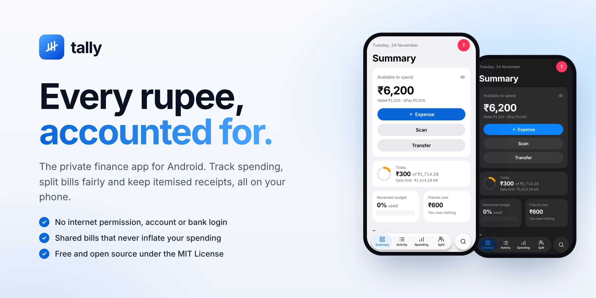
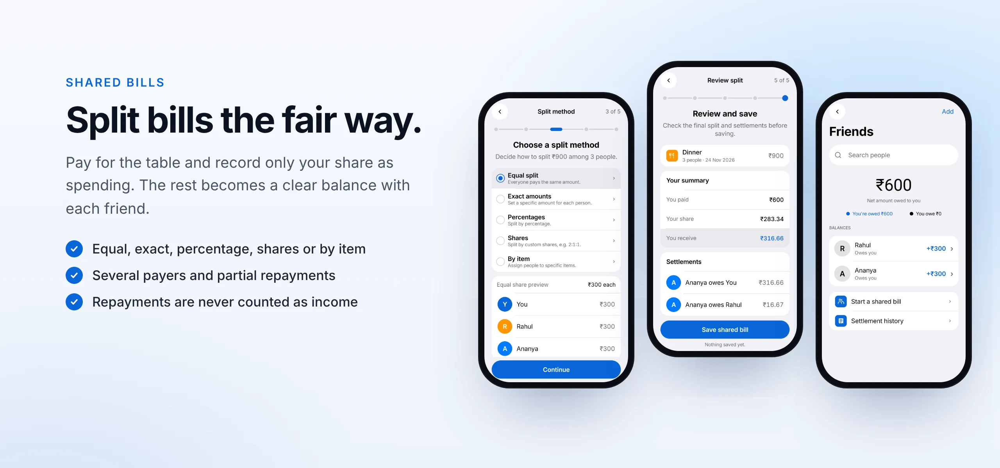
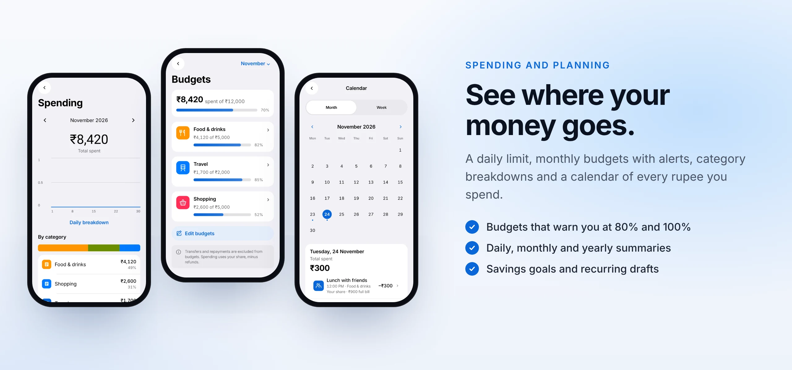
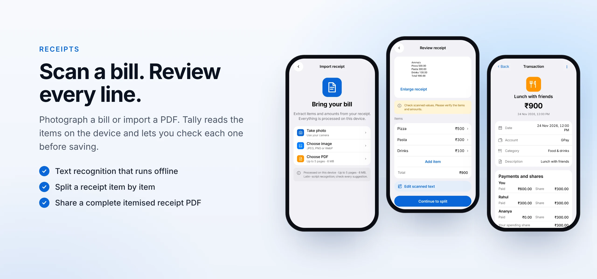
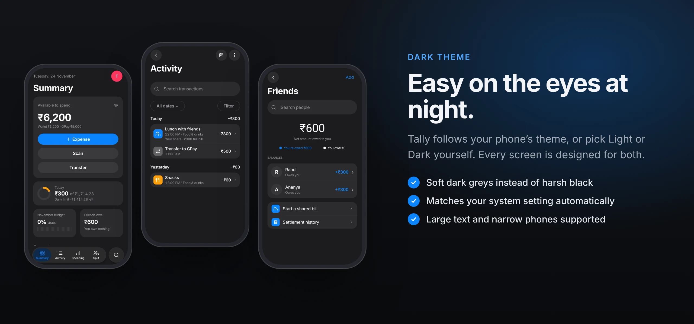
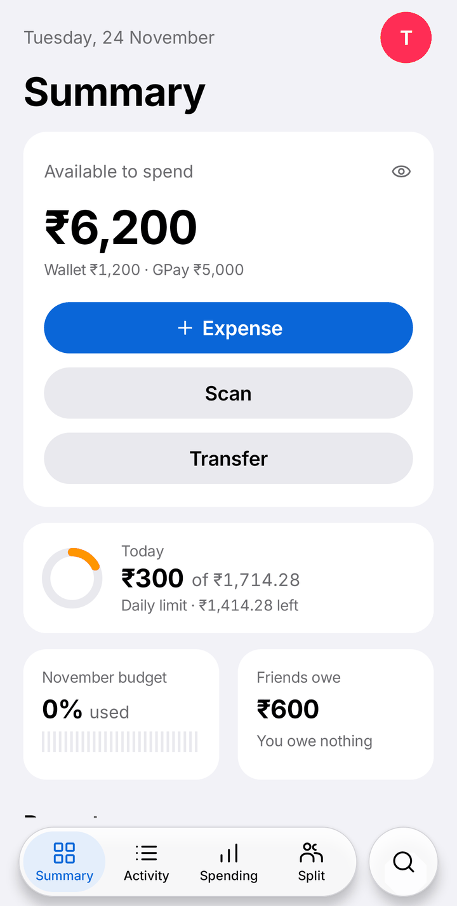
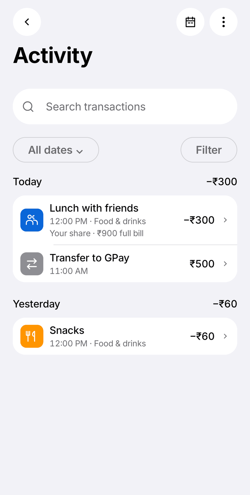
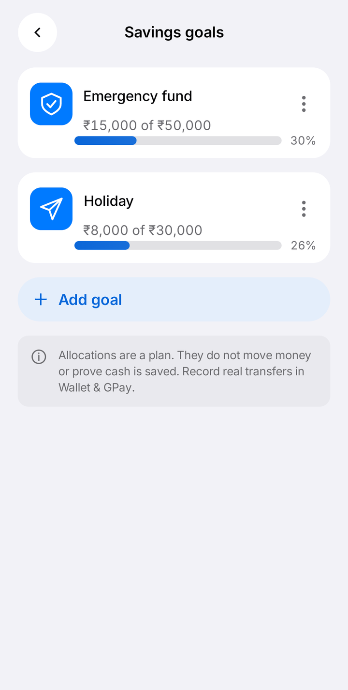
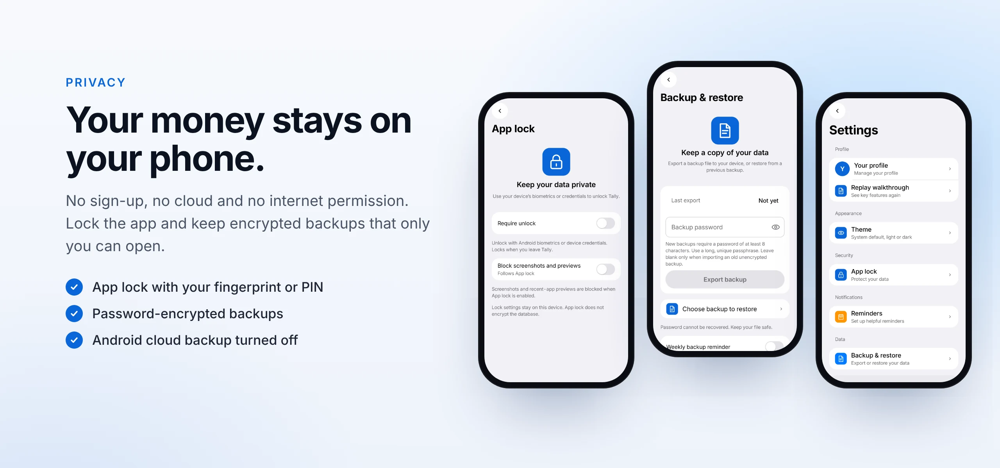

<a href="https://github.com/zack005-design/Tally/releases/latest"></a>

<p align="center">
  <a href="https://github.com/zack005-design/Tally/releases/latest"></a>
  <a href="https://github.com/zack005-design/Tally/actions/workflows/android.yml"></a>
  
  <a href="LICENSE"></a>
</p>

<p align="center">
  <a href="https://github.com/zack005-design/Tally/releases/latest"></a>
</p>

<p align="center">
  <a href="#features"><b>Features</b></a>&nbsp;&nbsp;&middot;&nbsp;&nbsp;<a href="#privacy"><b>Privacy</b></a>&nbsp;&nbsp;&middot;&nbsp;&nbsp;<a href="#download"><b>Download</b></a>&nbsp;&nbsp;&middot;&nbsp;&nbsp;<a href="#get-started"><b>Get started</b></a>&nbsp;&nbsp;&middot;&nbsp;&nbsp;<a href="#build-from-source"><b>Build</b></a>&nbsp;&nbsp;&middot;&nbsp;&nbsp;<a href="docs/README.md"><b>Guides</b></a>
</p>

<br>

Tally is a personal finance app for Android that works entirely on your phone. Record spending across your bank accounts, cash and UPI wallets, split bills with friends without inflating your own totals, and turn paper or PDF receipts into itemised records. There is no sign-up, no bank connection and no internet permission.

<table>
  <tr>
    <td width="33%" valign="top">
      <h4>Private by default</h4>
      No account, no cloud and no network access. Receipt reading and suggestions run on the device.
    </td>
    <td width="33%" valign="top">
      <h4>Honest totals</h4>
      What you paid stays separate from what you spent, so covering friends never counts against you.
    </td>
    <td width="33%" valign="top">
      <h4>Fast to record</h4>
      Add an expense from Summary, a short command like <code>coffee 80 cash</code>, a favourite or the widget.
    </td>
  </tr>
</table>

## Features

<a href="docs/features/shared-bills.md"></a>

<a href="docs/features/spending-and-planning.md"></a>

<a href="docs/features/receipts.md"></a>

<a href="docs/features/appearance.md"></a>

### Everything else

| Feature | What it does |
| --- | --- |
| **[Accounts and transactions](docs/features/everyday-money.md)** | Bank, cash and UPI balances; expenses, income, refunds and transfers; tags; search by text or amount. |
| **[Quick entry](docs/features/quick-entry.md)** | Short text commands, recent purchases, favourites and a home-screen widget, always confirmed before saving. |
| **[On-device suggestions](docs/features/on-device-ai.md)** | In the AI edition, a small model on your phone turns commands into editable drafts. It never saves on its own. |
| **[Reports and backups](docs/features/reports-and-backups.md)** | CSV and PDF reports with accounts and tags, and password-encrypted backups you can restore on any phone. |
| **[Calculator](docs/features/calculator.md)** | Splits, tax, tips, interest, statistics and unit conversions, kept apart from your records. |
| **[Every screen size](docs/phone-compatibility.md)** | Narrow phones scale to fit, landscape uses a side rail, and large text keeps controls usable. |

<p align="center">
  <a href="docs/screenshots/all-screens/README.md"></a>
  <a href="docs/screenshots/all-screens/README.md"></a>
  <a href="docs/screenshots/all-screens/README.md"></a>
  <a href="docs/screenshots/all-screens/README.md"></a>
  <a href="docs/screenshots/all-screens/README.md"></a>
  <br>
  <a href="docs/screenshots/all-screens/README.md"><b>Browse all 50 screens in light and dark &rarr;</b></a>
</p>

## Privacy

<a href="docs/features/privacy.md"></a>

<table>
  <tr>
    <th width="50%" align="left">What Tally does and does not do</th>
    <th width="50%" align="left">Permissions it asks for</th>
  </tr>
  <tr>
    <td valign="top">

| Question | Answer |
| --- | :---: |
| Works fully offline | Yes |
| Needs an account | No |
| Connects to banks or payment apps | No |
| Reads SMS messages | No |
| Sends analytics | No |
| Uses Android cloud backup | No |
| Encrypts exported backups | Yes |

</td>
    <td valign="top">

| Permission | Why |
| --- | --- |
| Biometrics | Optional app lock |
| Notifications | Optional reminders and budget alerts |
| Run at startup | Restore reminders after a restart |
| Internet | **Never requested** |

Every release is checked for the internet permission before it is published.

</td>
  </tr>
</table>

## Download

The latest version is **0.2.6**, for Android 8.0 and later. Choose **one** edition; both have the same finance and receipt features and share one app ID, so you can switch later without losing data.

| Edition | Best for | Download |
| --- | --- | --- |
| **AI** | Typing short commands that a small on-device model turns into drafts | [**tally-0.2.6-ai-debug.apk**](https://github.com/zack005-design/Tally/releases/download/v0.2.6-20261124/tally-0.2.6-ai-debug.apk) |
| **Non-AI** | Rule-based parsing and a smaller download | [**tally-0.2.6-non-ai-debug.apk**](https://github.com/zack005-design/Tally/releases/download/v0.2.6-20261124/tally-0.2.6-non-ai-debug.apk) |

Release notes, checksums and earlier versions are on the [releases page](https://github.com/zack005-design/Tally/releases).

> [!IMPORTANT]
> Export an encrypted backup before every update, then install the new APK over the old one. Never uninstall to update: uninstalling deletes your records.

> [!NOTE]
> Tally is in active development. These APKs are signed with a development key, not distributed through the Play Store, and have passed automated tests on Android 8, 15, 16 and 17 emulators but not yet on a physical phone.

## Get started

| If you are | Start here |
| --- | --- |
| **New to Tally** | Follow the [installation guide](docs/getting-started.md). The app walks you through your starting balances. |
| **Updating** | Read the [0.2.6 release notes](docs/releases/0.2.6.md), export a backup, then install over your current version. |
| **Switching editions** | See [downloads](docs/downloads.md); both editions read the same data. |
| **Bringing spending from a chat** | Use [chat history import](docs/features/chat-history-import.md) with the Tally Companion plugin. |

## Build from source

| Area | Choice |
| --- | --- |
| **Language and UI** | Kotlin, Jetpack Compose |
| **Storage** | Room, with exact integer-paise arithmetic |
| **Dependency injection** | Hilt |
| **Platforms** | Android 8.0 (API 26) to Android 17 (API 37) |
| **Quality checks** | Unit tests, Android lint and emulator tests on every change to `main` |

```bash
./gradlew :app:assembleDebug                      # AI edition
./gradlew :app:assembleDebug -PtallyAi=false      # Non-AI edition
./gradlew :app:testDebugUnitTest :app:lintDebug   # Unit tests and lint
```

See the [project structure](docs/project.md) for how the code is organised and [Build a signed release](docs/release-signing.md) for signing and publishing.

## Documentation

| Guide | Description |
| --- | --- |
| [User guides](docs/README.md) | Every feature, step by step |
| [App screens](docs/screenshots/all-screens/README.md) | All 50 screens in light and dark |
| [Changelog](CHANGELOG.md) | What changed in each release |
| [Contributing](CONTRIBUTING.md) | How to propose and test changes |
| [Security policy](SECURITY.md) | How to report a vulnerability privately |

Found a problem? [Open an issue](https://github.com/zack005-design/Tally/issues/new/choose).

## License

Tally is released under the [MIT License](LICENSE). The Inter typeface is used under the [SIL Open Font License](docs/licenses/Inter-OFL.txt).
