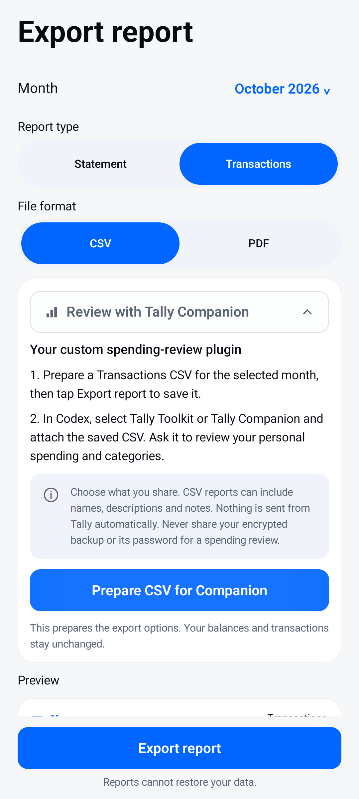

  

# Tally

**Track what you spend, what you can spend, and who owes you.**

Tally is an offline Android expense tracker for Wallet and GPay balances, personal spending, and shared bills. It calculates money in integer paise so payments, personal shares, refunds and repayments reconcile exactly.

**Android 8.0+ · Kotlin · Jetpack Compose · Room · Hilt · On-device ML Kit OCR**

[Download the APK](https://github.com/zack005-design/Tally/releases/download/v0.1.0-ios-polish-20261021/tally-ios-polish-debug.apk) · [Release and plugins](https://github.com/zack005-design/Tally/releases/tag/v0.1.0-ios-polish-20261021) · [Verification report](docs/verification/ios-polish-report.md)

The available APK is a development build, version **0.1.0**, for Android. It is not a Google Play release.

## App preview

  
  &nbsp;
  
  &nbsp;
  

Screenshots use fictional test data. Browse the [screen gallery files](docs/screenshots/all-screens/), or download the repository and open that folder's index.html locally for the interactive gallery.

## Features

| Area | What you can do |
| --- | --- |
| Accounts | Track Wallet, GPay and other accounts; set opening balances; add money; transfer funds; reconcile recorded balances. |
| Transactions | Record expenses, income and personal refunds; edit, duplicate or reverse entries; use offline text entry and favourite templates. |
| Shared bills | Record multiple payers and equal, weighted, percentage, fixed or itemized shares, including charges and discounts. |
| Friends | Track outstanding debts, partial repayments, settlement history and saved groups. |
| Receipts | Import photos or PDFs and review on-device OCR suggestions before saving. |
| Planning | Set category budgets, plan daily allowances, create recurring drafts and track savings goals. |
| History | Search transactions, browse a spending calendar, keep daily notes and review monthly cash movements. |
| Reports | Export Transactions or Statement reports to CSV or PDF. |
| Convenience | Use a home-screen expense widget, launcher shortcut and optional local reminders. |
| Protection | Enable an optional device-credential/biometric gate and export password-encrypted backups. |

The latest visual update adds a new launcher logo, iOS-inspired animations, and layouts that reflow for narrow screens and larger text.

### Shared bills keep cash and personal spending separate

For a ₹900 dinner split equally among three people, if you pay the whole bill:

- Your selected account decreases by ₹900.
- Your personal spending is ₹300.
- Your friends owe you ₹600 in total.

Their repayments increase your account balance and clear the debts without counting as income or spending.

## Start using Tally

1. Install the APK from the release link above.
2. Set Wallet and GPay starting balances in setup, or use **Set up Wallet & GPay** on Overview. Zero is a valid balance.
3. Tap the compose button to add an expense, or **Scan bill** to import a receipt. Review the values before saving.
4. Use **Friends** for shared balances, **Spending** for insights, and the top-right settings button for other tools.

Wallet and GPay are manually maintained accounts. Tally does not connect to Google Pay, banks, SMS messages or payment credentials. Its core currency is INR; foreign bills use a manually entered exchange rate.

## Custom Codex plugins

The [release downloads](https://github.com/zack005-design/Tally/releases/tag/v0.1.0-ios-polish-20261021) include **Tally Toolkit** and **Tally Companion** ZIPs.

- **Tally Toolkit** provides app development, verification and spending-export review guidance.
- **Tally Companion** reviews CSV reports that you choose to share with Codex.

In Tally, **Export report → Review with Tally Companion → Prepare CSV for Companion** selects the Transactions CSV options. Export the file, then explicitly attach it in Codex for review. The plugins run in Codex, not inside the Android app. Tally does not automatically upload your records.

## Privacy and backups

- Financial records and receipt attachments stay in the app's device storage.
- Tally has no Internet or network-state permission. OCR uses a bundled on-device model.
- Android automatic cloud backup is disabled. You control report and backup exports.
- Full backups use password-based AES-GCM encryption. There is no password-recovery service.
- CSV and PDF reports cannot restore the database.
- App lock controls access to Tally; it does not encrypt the local Room database.

## Build from source

### Requirements

- Android Studio or an Android SDK installation with **SDK Platform 36** and build tools.
- The configured **JetBrains JDK 25** Gradle daemon. The checked-in daemon criteria and Foojay resolver support toolchain provisioning. Application source and bytecode target Java 17.
- Internet access for initial dependency and toolchain downloads. The installed app itself operates offline.

Use the checked-in **Gradle 9.6.0** wrapper and **Android Gradle Plugin 9.4.1** configuration rather than a separate global Gradle installation.

    git clone https://github.com/zack005-design/Tally.git
    cd Tally

Open the project in Android Studio to configure the SDK location, or set ANDROID_HOME to your SDK directory. Keep machine-specific local.properties out of Git.

**Windows PowerShell:**

    .\gradlew.bat :app:assembleDebug

**macOS / Linux:**

    ./gradlew :app:assembleDebug

The output is app/build/outputs/apk/debug/app-debug.apk. The application ID is **com.smartexpense**, and its installed label is **Tally**.

## Verification

The 21 October 2026 verification recorded:

| Check | Result |
| --- | --- |
| JVM unit tests | 132 passed |
| Selected API 36 emulator tests | 41 passed |
| Additional animation-disabled checks | 4 passed |
| Debug assembly and APK signature | Passed |
| Packaged APK installation and launch | Passed on the emulator |
| Android lint | 0 errors, 32 warnings, 7 hints |

See the [report](docs/verification/ios-polish-report.md) and [saved evidence](docs/verification/ios-polish-evidence/). These are recorded local results; this repository currently has no GitHub Actions workflow. The selected device tests are not every historical instrumentation test. Physical devices, API 26, real camera/biometric hardware and store signing remain unverified in this delivery.

Run JVM tests, assembly and lint in PowerShell:

    .\gradlew.bat :app:testDebugUnitTest :app:assembleDebug :app:lintDebug

On macOS/Linux, use ./gradlew instead. With a connected Android device or emulator, run :app:connectedDebugAndroidTest for instrumentation tests; use disposable test data.

## Project layout

    app/src/main/java/com/smartexpense/
      domain/       Exact money calculations and financial rules
      data/         Room persistence, OCR, backups and reports
      ui/           Compose screens, state and shared components
      widget/       Home-screen expense widget
    app/src/test/          JVM tests
    app/src/androidTest/   Android, repository and UI tests
    app/schemas/           Versioned Room schemas
    docs/screenshots/      Curated app previews
    docs/verification/     Verification report and evidence
    gradle/                Wrapper and daemon configuration

The current Room schema is **5**. New full backups use format **7**. Keep schema exports, migrations and backup compatibility in sync when changing persisted data.

## Contributing and licensing

Use feature branches and pull requests for proposed changes. **main** holds the integrated app source.

[Report an issue](https://github.com/zack005-design/Tally/issues) with the app version, device/Android version and reproduction steps. Avoid sharing private financial records.

The bundled Plus Jakarta Sans font is covered by its [SIL Open Font License](docs/licenses/PlusJakartaSans-OFL.txt). No application source-code license is currently declared in this repository.
