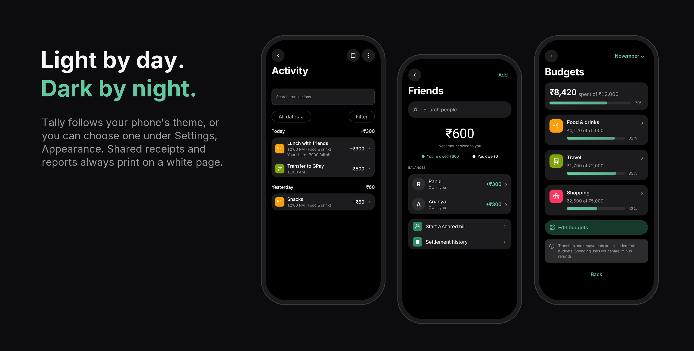

<a href="https://github.com/zack005-design/Tally/releases/latest"></a>

<p align="center">
  <a href="https://github.com/zack005-design/Tally/releases/latest"></a>
  <a href="https://github.com/zack005-design/Tally/actions/workflows/android.yml"></a>
  
  
  
</p>

<p align="center">
  <a href="https://github.com/zack005-design/Tally/releases/latest"></a>
</p>

<p align="center">
  <a href="#overview">Overview</a>&nbsp;&nbsp;&middot;&nbsp;&nbsp;<a href="#features">Features</a>&nbsp;&nbsp;&middot;&nbsp;&nbsp;<a href="#privacy">Privacy</a>&nbsp;&nbsp;&middot;&nbsp;&nbsp;<a href="#download">Download</a>&nbsp;&nbsp;&middot;&nbsp;&nbsp;<a href="#build-from-source">Build</a>&nbsp;&nbsp;&middot;&nbsp;&nbsp;<a href="docs/README.md">Documentation</a>
</p>

<br>

## Overview

Tally is a personal finance app for Android that runs entirely on your phone. It records spending across your accounts, splits shared bills fairly and turns paper or PDF receipts into itemised records. There is no sign-up, no bank connection and no internet permission.


<table>
  <tr>
    <td width="33%" valign="top">
      <b>Private by design</b><br>
      No account, no cloud and no network access. Receipt reading and suggestions run on the device.
    </td>
    <td width="33%" valign="top">
      <b>Accurate shared spending</b><br>
      What you paid is kept separate from what you spent, so covering friends never inflates your totals.
    </td>
    <td width="33%" valign="top">
      <b>Quick to use</b><br>
      Record an expense in seconds from Summary, a text command, a favourite or the home-screen widget.
    </td>
  </tr>
</table>

## Features

<table>
  <tr>
    <td width="50%" valign="top">
      <h4><a href="docs/features/everyday-money.md">Accounts and transactions</a></h4>
      Keep balances for bank accounts, cash, GPay and more. Record expenses, income, refunds and transfers, reconcile balances, tag entries and search by text or amount.
    </td>
    <td width="50%" valign="top">
      <h4><a href="docs/features/shared-bills.md">Shared bills</a></h4>
      Split equally or by amount, percentage, shares or item. Handle several payers, partial repayments and a running balance with each friend.
    </td>
  </tr>
  <tr>
    <td valign="top">
      <h4><a href="docs/features/receipts.md">Receipts</a></h4>
      Scan a photo or PDF, check the recognised items and save. Share a complete itemised receipt PDF with the original scan attached.
    </td>
    <td valign="top">
      <h4><a href="docs/features/spending-and-planning.md">Spending and planning</a></h4>
      A daily spending limit, category and calendar views, a yearly summary, monthly budgets with alerts, allowances, recurring drafts and savings goals.
    </td>
  </tr>
  <tr>
    <td valign="top">
      <h4><a href="docs/features/quick-entry.md">Quick entry</a></h4>
      Type <code>coffee 80 cash</code>, repeat a recent purchase, use favourites or the widget. Every entry is confirmed before it is saved.
    </td>
    <td valign="top">
      <h4><a href="docs/features/on-device-ai.md">On-device suggestions</a></h4>
      In the AI edition, a small model on your phone turns short commands into editable drafts. It never saves anything by itself.
    </td>
  </tr>
  <tr>
    <td valign="top">
      <h4><a href="docs/features/reports-and-backups.md">Reports and backups</a></h4>
      Export monthly reports and account lists as CSV or PDF, and create password-encrypted backups you can restore on any phone.
    </td>
    <td valign="top">
      <h4><a href="docs/features/calculator.md">Calculator</a></h4>
      Splits, tax, tips, interest, statistics and unit conversions, kept separate from your records.
    </td>
  </tr>
</table>

## Shared bills, recorded correctly


Your share counts as spending, and the rest becomes a balance with each friend. Repayments are never treated as income, and transfers between your own accounts are never counted as spending.

## Designed for every screen



- **Light and dark themes.** Tally follows your phone's theme by default. Choose Light or Dark under **Settings &rarr; Appearance**. See the [appearance guide](docs/features/appearance.md).
- **Familiar layout.** Grouped lists, clear typography and a floating tab bar for Summary, Activity, Spending and Split, with search one tap away.
- **Adaptive layouts.** Narrow phones scale the layout so nothing is cut off. Landscape screens use a side navigation rail, and large text keeps controls on one row wherever they fit.

## Privacy

| Protection | How it works |
| --- | --- |
| **Offline by design** | The app has no internet permission. Receipt recognition, suggestions and calculations all run on the device. |
| **No bank access** | Tally never reads your bank, payment apps, SMS messages or card details. You keep the balances yourself. |
| **App lock** | Lock Tally with your device PIN, pattern, password or biometrics. |
| **Encrypted backups** | Backups are protected by your password. Automatic Android cloud backup is turned off. |
| **Sharing on your terms** | Reports and receipts are exported only when you ask. Shared receipts leave out private notes and account balances. |

More detail is in the [privacy guide](docs/features/privacy.md).

## Download

The latest published version is **0.2.4**, for Android 8.0 and later. Tally comes in two editions with the same finance and receipt features.

| Edition | Quick entry | APK |
| --- | --- | --- |
| **AI** | A local model suggests drafts, with rules as a fallback | [tally-0.2.4-ai-debug.apk](https://github.com/zack005-design/Tally/releases/download/v0.2.4-20261115/tally-0.2.4-ai-debug.apk) |
| **Non-AI** | Rule-based parsing only | [tally-0.2.4-non-ai-debug.apk](https://github.com/zack005-design/Tally/releases/download/v0.2.4-20261115/tally-0.2.4-non-ai-debug.apk) |

Both editions share one app ID, so you can switch between them without losing data. Make an encrypted backup before updating, and follow the [installation guide](docs/getting-started.md) for step-by-step instructions.

> [!NOTE]
> Tally is in active development, and these APKs are debug-signed test builds that are not on the Play Store. The redesign, dark theme and adaptive layouts shown above are on `main` and will be included in the next release. See the [changelog](CHANGELOG.md).

## Build from source

Tally is written in Kotlin with Jetpack Compose, Room and Hilt, and targets Android 17 (API 37).

```bash
./gradlew :app:assembleDebug                      # AI edition
./gradlew :app:assembleDebug -PtallyAi=false      # Non-AI edition
./gradlew :app:testDebugUnitTest :app:lintDebug   # Unit tests and lint
```

## Documentation

| Guide | Description |
| --- | --- |
| [Installation guide](docs/getting-started.md) | Install, update and switch editions safely |
| [User guides](docs/README.md) | Every feature, step by step |
| [Screen gallery](docs/screenshots/all-screens/README.md) | Captures of every screen |
| [Changelog](CHANGELOG.md) | What changed in each release |
| [Contributing](CONTRIBUTING.md) | How to propose and test changes |

Found a problem? [Report an issue](https://github.com/zack005-design/Tally/issues/new/choose).
