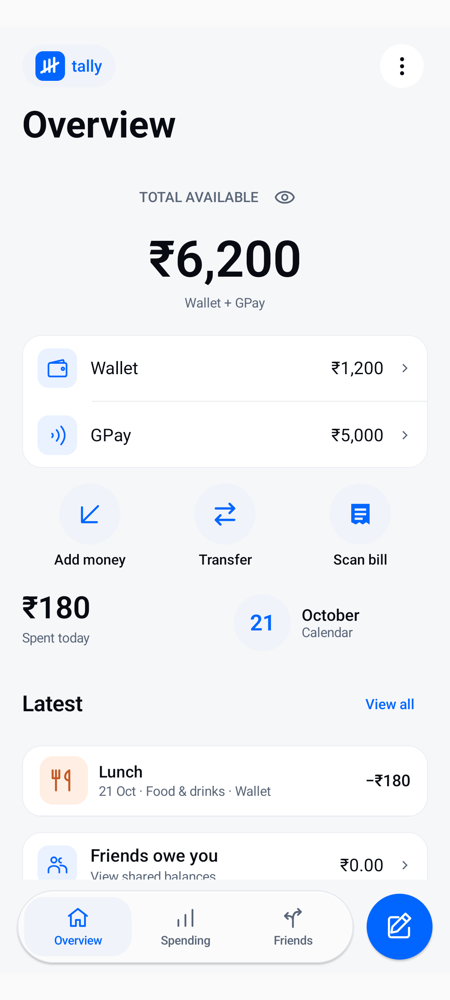
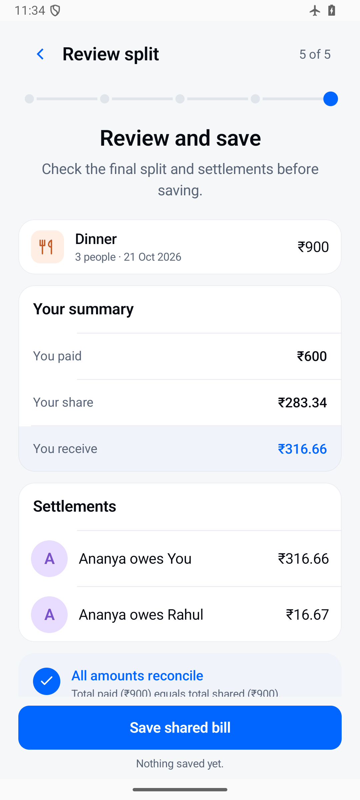
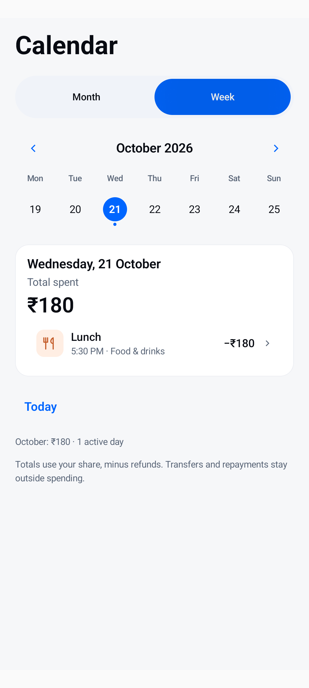

  

<h1 align="center">Tally</h1>

  <strong>Your everyday money, clearly accounted for.</strong> 
  An offline Android app for personal spending, account balances, and shared expenses.

  

  <a href="#screens">Explore the app</a>
  &nbsp;·&nbsp;
  <a href="#features">Features</a>
  &nbsp;·&nbsp;
  <a href="docs/README.md">Guides</a>
  &nbsp;·&nbsp;
  <a href="#privacy">Privacy</a>
  &nbsp;·&nbsp;
  <a href="https://github.com/zack005-design/Tally/releases">Releases</a>

## Screens

<table align="center" width="100%">
  <tr>
    <th align="center" width="33%"><a href="docs/screenshots/readme/overview.png">Your money at a glance</a></th>
    <th align="center" width="33%"><a href="docs/screenshots/readme/shared-bill.png">A clear view of every split</a></th>
    <th align="center" width="33%"><a href="docs/screenshots/readme/calendar.png">Spending, day by day</a></th>
  </tr>
  <tr>
    <td align="center" valign="top" width="33%"></td>
    <td align="center" valign="top" width="33%"></td>
    <td align="center" valign="top" width="33%"></td>
  </tr>
  <tr>
    <td align="center" valign="top" width="33%">Balances, recent activity, and quick actions.</td>
    <td align="center" valign="top" width="33%">What you paid, your share, and who owes whom.</td>
    <td align="center" valign="top" width="33%">Daily totals with the transactions behind them.</td>
  </tr>
</table>

*Real app captures with fictional data. Click any screen to open it at full size, or [browse the complete gallery](docs/screenshots/all-screens/README.md).*

## Features

**New: offline calculations and expense commands.** Open **More → Money & planning → Calculate** for arithmetic, percentages, equal bill splits, unit conversions, and simple equations. Type a request, use an example, or choose guided fields. Results show the interpreted calculation and never change your records. See the [calculator guide](ml/tally-command/CALCULATOR.md) and [scratch-trained expense model](ml/tally-command/COMMAND_MODEL.md) for supported inputs and limits. No pretrained model weights are used.

<table align="center" width="100%">
  <tr>
    <td width="50%" align="left" valign="top">
      <h3><a href="docs/features/everyday-money.md">Everyday money</a></h3>
      
Track Wallet, GPay, and other account balances. Record expenses, income, and personal refunds; add funds, transfer money, and reconcile your balances.

    </td>
    <td width="50%" align="left" valign="top">
      <h3><a href="docs/features/shared-bills.md">Shared bills and repayments</a></h3>
      
Split equally or by amounts, percentages, weights, or items. Handle multiple payers, track what friends owe, and record partial repayments.

    </td>
  </tr>
  <tr>
    <td width="50%" align="left" valign="top">
      <h3><a href="docs/features/receipts.md">Receipts, without retyping</a></h3>
      
Import a photo or PDF and review text recognized on your device. Confirm the items, amounts, and payment details before saving.

    </td>
    <td width="50%" align="left" valign="top">
      <h3><a href="docs/features/spending-and-planning.md">Spending and planning</a></h3>
      
Explore transactions by day and category. Set monthly budgets, plan allowances, create recurring drafts, and track savings goals.

    </td>
  </tr>
  <tr>
    <td width="50%" align="left" valign="top">
      <h3><a href="docs/features/reports-and-backups.md">Reports and backups</a></h3>
      
Export monthly CSV or PDF reports for review. Create a separate, password-encrypted full backup when you need a restorable copy of your data.

    </td>
    <td width="50%" align="left" valign="top">
      <h3><a href="docs/features/quick-entry.md">Quicker daily entry</a></h3>
      
Reuse favourite expenses or repeat a recent purchase. Reach entry through the home-screen widget or launcher shortcut, with explicit confirmation before saving.

    </td>
  </tr>
</table>

## Your payment and your share

See what you paid, what you personally spent, and what remains to be settled.

For a **₹900 dinner split equally among three people**, when you pay the whole amount:

<table align="center" width="100%">
  <tr>
    <td align="center" width="33%" valign="top"><h3><a href="docs/features/payment-and-share.md#what-you-paid">₹900</a></h3>Leaves your account</td>
    <td align="center" width="33%" valign="top"><h3><a href="docs/features/payment-and-share.md#your-personal-share">₹300</a></h3>Your personal spending</td>
    <td align="center" width="33%" valign="top"><h3><a href="docs/features/payment-and-share.md#what-remains-to-be-settled">₹600</a></h3>Owed to you by friends</td>
  </tr>
</table>

Repayments reduce what is owed without becoming new income. Transfers between your own accounts stay separate from spending.

[Explore payments, shares, and settlements →](docs/features/payment-and-share.md)

## Privacy

**Your records stay on your device.** Tally has no Internet permission, and receipt recognition uses a bundled on-device model.

- **No bank connection.** Wallet and GPay are balances you maintain manually; Tally does not access banks, Google Pay, SMS messages, or payment credentials.
- **Optional app lock.** Restrict access with supported device credentials or biometric authentication.
- **Encrypted backups.** Export a password-protected full backup. Automatic Android cloud backup is disabled.
- **Sharing is your choice.** CSV and PDF reports are for reading and analysis, not database restoration. You choose when and where to export them.

[Read about privacy and app lock →](docs/features/privacy.md)

## Tally Companion

Review an exported Transactions CSV with your custom Codex plugins. The [export guide](docs/features/reports-and-backups.md#review-an-export-with-tally-companion) explains how to prepare the file; you explicitly attach it in Codex.

[Download Tally Companion](https://github.com/zack005-design/Tally/releases/download/v0.1.0-ios-polish-20261021/tally-companion-0.1.0.zip) &nbsp;·&nbsp; [Download Tally Toolkit](https://github.com/zack005-design/Tally/releases/download/v0.1.0-ios-polish-20261021/tally-toolkit-0.1.0.zip)

These plugins run separately in Codex. Tally does not send your records automatically.

[Learn how to use Tally Companion →](docs/features/companion.md)

## Release information

**Android 8.0+ · Version 0.1.0 · Development build**

INR is the core currency. Foreign bills can use a manually entered exchange rate. See [download and setup](docs/getting-started.md) for installation and release details, or the [verification report](docs/verification/ios-polish-report.md) for recorded test results and device-testing limits.

  <a href="https://github.com/zack005-design/Tally/releases">Latest release</a>
  &nbsp;·&nbsp;
  <a href="docs/screenshots/all-screens/README.md">Screen gallery</a>
  &nbsp;·&nbsp;
  <a href="https://github.com/zack005-design/Tally/issues">Feedback and issues</a>

