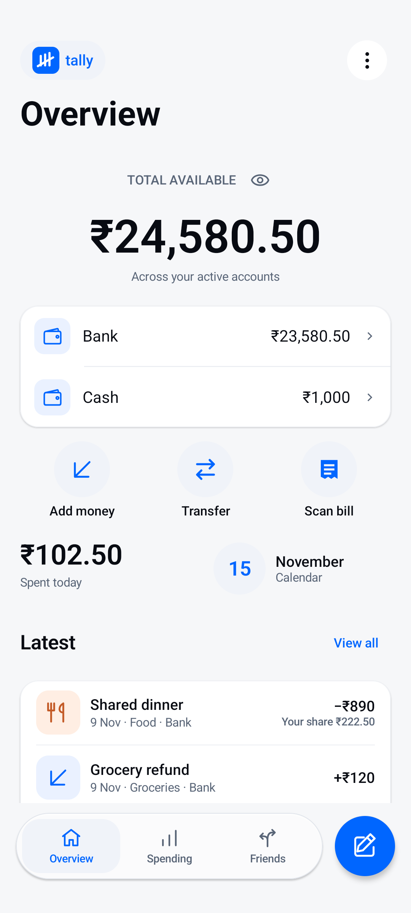
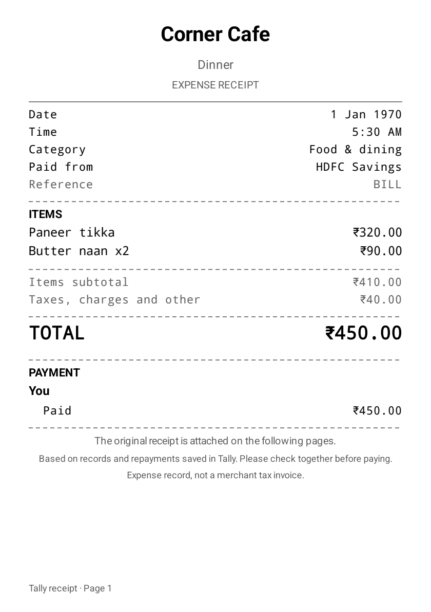

<p align="center">
  <a href="https://github.com/zack005-design/Tally/releases/latest"></a>
</p>

<p align="center">
  <a href="https://github.com/zack005-design/Tally/releases/latest"></a>
  <a href="https://github.com/zack005-design/Tally/actions/workflows/android.yml"></a>
  
  
</p>

# Tally

Tally is an offline Android app for tracking personal spending, splitting bills with friends and keeping itemised receipts. All data stays on the device: there is no account, no bank connection and no internet permission.

<p align="center">
  <a href="https://github.com/zack005-design/Tally/releases/latest"></a>
</p>

## Screenshots

<table>
  <tr>
    <td align="center" width="25%"></td>
    <td align="center" width="25%"></td>
    <td align="center" width="25%"></td>
    <td align="center" width="25%"></td>
  </tr>
  <tr>
    <td align="center"><sub>Overview</sub></td>
    <td align="center"><sub>Spending</sub></td>
    <td align="center"><sub>Friends</sub></td>
    <td align="center"><sub>Receipt PDF</sub></td>
  </tr>
</table>

<sub>Version 0.2.4 on an Android emulator with fictional data. See the <a href="docs/screenshots/all-screens/README.md">full screen gallery</a>.</sub>

## Features

| Area | What it covers |
| --- | --- |
| [Accounts and transactions](docs/features/everyday-money.md) | Wallet, GPay and other accounts; expenses, income, refunds, transfers and balance reconciliation. |
| [Shared bills](docs/features/shared-bills.md) | Equal, amount, percentage, weight or item-based splits, multiple payers and partial repayments. |
| [Receipts](docs/features/receipts.md) | On-device scanning of photos and PDFs, item review, and shareable itemised receipt PDFs. |
| [Spending and planning](docs/features/spending-and-planning.md) | Daily and category views, monthly budgets with optional alerts, allowances, recurring drafts and savings goals. |
| [Quick entry](docs/features/quick-entry.md) | Short commands such as `coffee 80 cash`, favourites, repeat purchases and a home-screen widget. |
| [On-device suggestions](docs/features/on-device-ai.md) | A small local model turns short commands into editable drafts (AI edition only). |
| [Calculator](docs/features/calculator.md) | Splits, tax, tips, interest, statistics and conversions, kept separate from the ledger. |
| [Reports and backups](docs/features/reports-and-backups.md) | Monthly CSV and PDF reports, and password-encrypted full backups. |

Tally separates what you paid from what you spent. If you pay ₹900 for a dinner split three ways, ₹900 leaves your account, ₹300 counts as your spending and ₹600 is recorded as owed to you. Repayments settle that balance without being counted as income, and transfers between your own accounts are never counted as spending. See [payments, shares and settlements](docs/features/payment-and-share.md).

Every entry, whether typed, scanned or suggested, is shown for review before it is saved.

## Privacy

- **No internet permission.** Receipt recognition, suggestions and calculations run entirely on the device.
- **No bank or SMS access.** Tally does not read bank accounts, payment apps, SMS messages or payment details.
- **App lock** using the device PIN, pattern, password or biometrics (optional).
- **Encrypted backups** protected by your password. Android cloud backup is disabled.
- **Explicit sharing only.** Reports and receipts are exported only when you request them, and shared receipts exclude private notes and account balances.

See [privacy and app lock](docs/features/privacy.md).

## Installation

Latest version: **0.2.4** (development build) · Requires Android 8.0 or later

| Edition | Expense entry | Download |
| --- | --- | --- |
| AI | Local model suggestions, with rule-based fallback | [tally-0.2.4-ai-debug.apk](https://github.com/zack005-design/Tally/releases/download/v0.2.4-20261115/tally-0.2.4-ai-debug.apk) |
| Non-AI | Rule-based parsing only | [tally-0.2.4-non-ai-debug.apk](https://github.com/zack005-design/Tally/releases/download/v0.2.4-20261115/tally-0.2.4-non-ai-debug.apk) |

Both editions include every finance and receipt feature and share the same app ID, so either one installs over 0.2.3 or over the other edition without losing data. Create an encrypted backup before updating.

- [Installation guide](docs/getting-started.md)
- [All downloads and checksums](docs/downloads.md)
- [Installation safety](docs/installation-safety.md)
- [Release notes for 0.2.4](docs/releases/0.2.4.md)

## Project status

Tally is under active development. Current APKs are debug-signed test builds and are not distributed through the Play Store. Each change is checked in CI with unit tests, Android lint and database compatibility tests on Android 8, 15, 16 and 17. Testing on physical devices is still pending. The ledger uses Indian rupees; foreign-currency bills use an exchange rate you enter.

For verification details and known limitations, see the [0.2.4 release notes](docs/releases/0.2.4.md) and the [changelog](CHANGELOG.md).

## Building from source

Tally is written in Kotlin with Jetpack Compose, Room and Hilt. Finance logic lives in a plain Kotlin domain layer, separate from the UI and Android services. The project targets Android 17 (API 37) and uses Android Gradle Plugin 9.

```bash
./gradlew :app:assembleDebug                      # AI edition
./gradlew :app:assembleDebug -PtallyAi=false      # Non-AI edition
./gradlew :app:testDebugUnitTest :app:lintDebug   # Unit tests and lint
```

## Documentation

- [User guides](docs/README.md)
- [Source guide](docs/project.md)
- [On-device model design](ml/tally-command/COMMAND_MODEL.md) and [evaluation](ml/tally-command/VERIFICATION_V3.md)
- [Tally Companion](docs/features/companion.md), an optional, separate plugin for reviewing exported CSVs and [importing chat history](docs/features/chat-history-import.md)
- [Contributing](CONTRIBUTING.md)
- [Report a bug](https://github.com/zack005-design/Tally/issues/new/choose)
