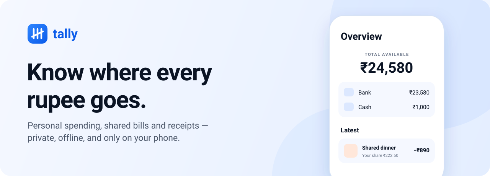
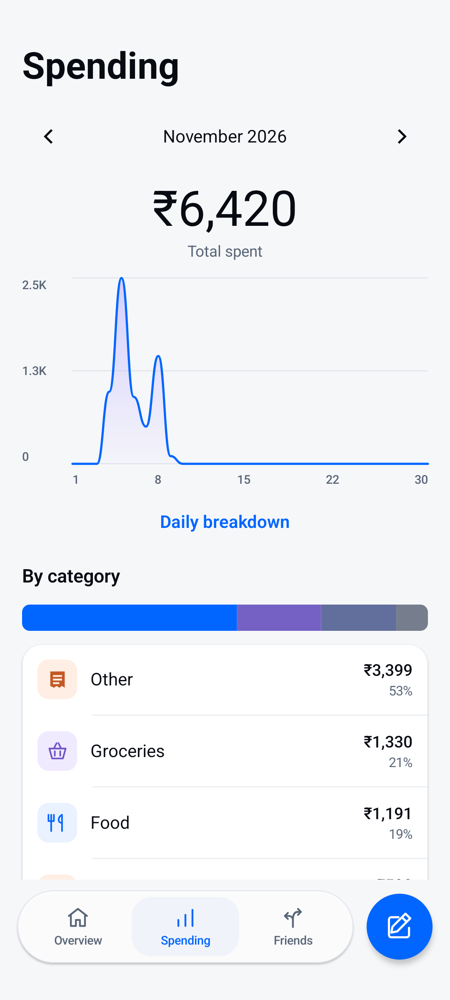
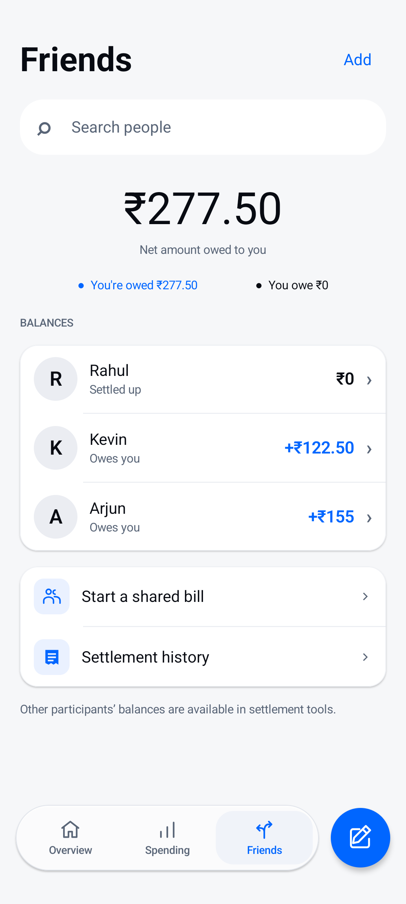

<p align="center">
  <a href="https://github.com/zack005-design/Tally/releases/latest"></a>
</p>

<p align="center">
  <a href="https://github.com/zack005-design/Tally/releases/latest"></a>
  <a href="https://github.com/zack005-design/Tally/actions/workflows/android.yml"></a>
  
  
  
</p>

<p align="center">
  <b>Tally</b> tracks your accounts, splits bills with friends and turns receipts into records.<br>
  Everything stays on your phone. No account, no bank login, no cloud.
</p>

<p align="center">
  <a href="https://github.com/zack005-design/Tally/releases/latest"></a>
</p>

<p align="center">
  <a href="#see-it">See it</a> ·
  <a href="#what-it-does">Features</a> ·
  <a href="#receipts-you-can-share">Receipts</a> ·
  <a href="#private-by-design">Privacy</a> ·
  <a href="#install">Install</a> ·
  <a href="docs/README.md">Guides</a>
</p>

---

## See it

<table>
  <tr>
    <td align="center" width="25%"><a href="docs/screenshots/readme/home.png"></a></td>
    <td align="center" width="25%"><a href="docs/screenshots/readme/spending.png"></a></td>
    <td align="center" width="25%"><a href="docs/screenshots/readme/friends.png"></a></td>
    <td align="center" width="25%"><a href="docs/screenshots/readme/receipt-pdf.png"></a></td>
  </tr>
  <tr>
    <td align="center"><b>Overview</b><br><sub>Every balance and today's spending</sub></td>
    <td align="center"><b>Spending</b><br><sub>Day by day and by category</sub></td>
    <td align="center"><b>Friends</b><br><sub>Who owes whom, at a glance</sub></td>
    <td align="center"><b>Receipt PDF</b><br><sub>Itemised, ready to share</sub></td>
  </tr>
</table>

<sub>Captured from version 0.2.4 on an Android emulator with fictional data. <a href="docs/screenshots/all-screens/README.md">More screens</a>.</sub>

## Why Tally

<table>
  <tr>
    <td width="33%" valign="top">
      <h3>🔒 Yours alone</h3>
      The app has no internet permission. Your records, receipts and backups never leave the phone unless you share them.
    </td>
    <td width="33%" valign="top">
      <h3>🤝 Fair splits</h3>
      See what you paid, what you actually spent and what friends owe, without repayments turning into fake income.
    </td>
    <td width="33%" valign="top">
      <h3>⚡ Fast entry</h3>
      Type <code>coffee 80 cash</code>, scan a bill or tap a favourite. You review everything before it is saved.
    </td>
  </tr>
</table>

## What it does

| | |
| --- | --- |
| 💰 **[Everyday money](docs/features/everyday-money.md)**<br>Track Wallet, GPay and other accounts. Record expenses, income and refunds, transfer money and reconcile balances. | 👥 **[Shared bills](docs/features/shared-bills.md)**<br>Split equally or by amounts, percentages, weights or items. Handle several payers and partial repayments. |
| 🧾 **[Receipts](docs/features/receipts.md)**<br>Scan a photo or PDF, check the recognised items and save. Share a complete itemised receipt PDF. | 📊 **[Spending and planning](docs/features/spending-and-planning.md)**<br>Daily and category views, monthly budgets with optional alerts, allowances, recurring drafts and savings goals. |
| ✨ **[On-device suggestions](docs/features/on-device-ai.md)**<br>Turn a short command into an editable draft. The AI edition runs a small model locally. | 🧮 **[Calculator](docs/features/calculator.md)**<br>Totals, splits, tax, tips, interest, statistics and unit or currency conversion, kept separate from your ledger. |
| 📤 **[Reports and backups](docs/features/reports-and-backups.md)**<br>Monthly CSV or PDF reports, and password-encrypted full backups you can restore. | ⚡ **[Quick entry](docs/features/quick-entry.md)**<br>Favourites, repeat a recent purchase, and a home-screen widget, always with a confirmation step. |

## Your payment and your share

A **₹900 dinner split equally between three people**, when you pay the whole bill:

<table>
  <tr>
    <td align="center" width="33%"><h2>₹900</h2>leaves your account</td>
    <td align="center" width="33%"><h2>₹300</h2>counts as your spending</td>
    <td align="center" width="33%"><h2>₹600</h2>is owed to you by friends</td>
  </tr>
</table>

Repayments reduce what is owed without becoming income, and transfers between your own accounts never count as spending. [How payments, shares and settlements work →](docs/features/payment-and-share.md)

## Receipts you can share


Open a saved expense and tap **Share receipt PDF** to get a proper receipt, not a summary:

- merchant, date and time, category and the account you paid from
- every item with its price, then taxes or discounts and the total
- who paid, each person's share and what is still owed
- the original receipt photo or PDF on the pages after

Private notes and account balances are never included. Receipt text is recognised on the phone, and you confirm every item before it is saved.

[Scanning and sharing receipts →](docs/features/receipts.md)

<br clear="right">

## Private by design

- **No internet permission.** Recognition, suggestions and calculations all run on the device.
- **No bank connection.** Tally never reads your bank, Google Pay, SMS messages or payment details. Balances are ones you keep.
- **Optional app lock** with your device PIN, pattern, password or biometrics.
- **Encrypted backups** protected by your password. Automatic Android cloud backup is turned off.
- **You choose what to share.** Reports and receipts are only exported when you ask.

[Privacy and app lock →](docs/features/privacy.md)

## Install

**Version 0.2.4 · Android 8.0 or later · development build**

| Edition | Expense entry | Download |
| --- | --- | --- |
| **AI** | Local model suggestions, with rules as a fallback | [tally-0.2.4-ai-debug.apk](https://github.com/zack005-design/Tally/releases/download/v0.2.4-20261115/tally-0.2.4-ai-debug.apk) |
| **Non-AI** | Rule-based parsing, without the model | [tally-0.2.4-non-ai-debug.apk](https://github.com/zack005-design/Tally/releases/download/v0.2.4-20261115/tally-0.2.4-non-ai-debug.apk) |

Both editions include every finance feature and receipt scanning. They share one app identity, so either installs over 0.2.3 or over the other edition and keeps your data. Make an encrypted backup before updating.

[Step-by-step install guide](docs/getting-started.md) · [All downloads and checksums](docs/downloads.md) · [What's new in 0.2.4](docs/releases/0.2.4.md)

<details>
<summary><b>About the on-device AI</b></summary>

<br>

The AI edition uses a small, purpose-built expense-command model. It turns short English input such as `coffee 80 cash` into a draft with a description, a rupee amount and an account hint. It runs on the phone with no API key or cloud service, and it never saves anything by itself.

The core model has **53,142 parameters** in a roughly **210 KiB** bundle, trained from scratch on synthetic commands, with an integrated extension for wider phrasing. It picks text and amount spans from what you typed, and exact decimal code converts money to paise. Unsupported or low-confidence input falls back to rules or asks you to correct it.

| Component | Role | Where it runs |
| --- | --- | --- |
| Expense-command model | Suggests single-rupee personal-expense drafts (AI edition) | On your phone |
| Receipt recognition and PDFs | Reads imported receipts and shares itemised receipt PDFs (both editions) | On your phone |
| Calculator | Deterministic rules and decimal arithmetic | On your phone |
| Tally Companion | Reviews exports or prepares a chat-history import you explicitly share | Separately, in Codex |

It is not a chat assistant and does not answer questions about your history.

[Usage and limits](docs/features/on-device-ai.md) · [Model design](ml/tally-command/COMMAND_MODEL.md) · [Recorded evaluation](ml/tally-command/VERIFICATION_V3.md) · [Model research](ml/tally-command/MODEL_LADDER.md)

</details>

<details>
<summary><b>Tally Companion plugin</b></summary>

<br>

Tally Companion 0.2.0 runs in Codex, separately from the app. It reviews a Transactions CSV exported from Tally, or prepares spending history from a ChatGPT conversation for import. Imported entries are previewed and need your confirmation; unsupported records stay flagged for manual handling. Tally never sends records anywhere automatically.

[Download Tally Companion](docs/downloads.md#tally-companion) · [Download Tally Toolkit](docs/downloads.md#tally-toolkit) · [Export review](docs/features/companion.md) · [Chat-history import](docs/features/chat-history-import.md)

</details>

<details>
<summary><b>Release status and testing</b></summary>

<br>

Tally is in active development. The 0.2.4 APKs are debug-signed test builds, not Play Store releases.

- **238 unit tests** pass for each edition, and Android lint reports no issues.
- The full instrumented suite passes on an Android 16 emulator (357 of 358; the remaining case is an intentional skip).
- CI runs database and compatibility checks on Android 8, 15, 16 and 17 for every change.
- Testing on physical phones is still pending.

Rupees are the core currency; foreign bills use an exchange rate you enter. [Verification and limits](docs/releases/0.2.4.md) · [Installation safety](docs/installation-safety.md) · [Changelog](CHANGELOG.md)

</details>

## Build from source

Tally is written in Kotlin with Jetpack Compose, Room for local storage and Hilt for dependency injection. Finance calculations live in a plain Kotlin domain layer, separate from the UI and Android services, and every change to the ledger is confirmed by the user.

```bash
./gradlew :app:assembleDebug                 # AI edition
./gradlew :app:assembleDebug -PtallyAi=false # non-AI edition
./gradlew :app:testDebugUnitTest :app:lintDebug
```

The source targets Android 17 (API 37) with AGP 9. Changes since the last download are listed under [Unreleased](CHANGELOG.md#unreleased).

[Source guide](docs/project.md) · [User guides](docs/README.md) · [Contributing](CONTRIBUTING.md) · [Report a bug](https://github.com/zack005-design/Tally/issues/new/choose)

---

<p align="center">
  <a href="https://github.com/zack005-design/Tally/releases/latest">Latest release</a> ·
  <a href="docs/screenshots/all-screens/README.md">Screen gallery</a> ·
  <a href="CHANGELOG.md">Changelog</a> ·
  <a href="https://github.com/zack005-design/Tally/issues">Feedback</a>
</p>
