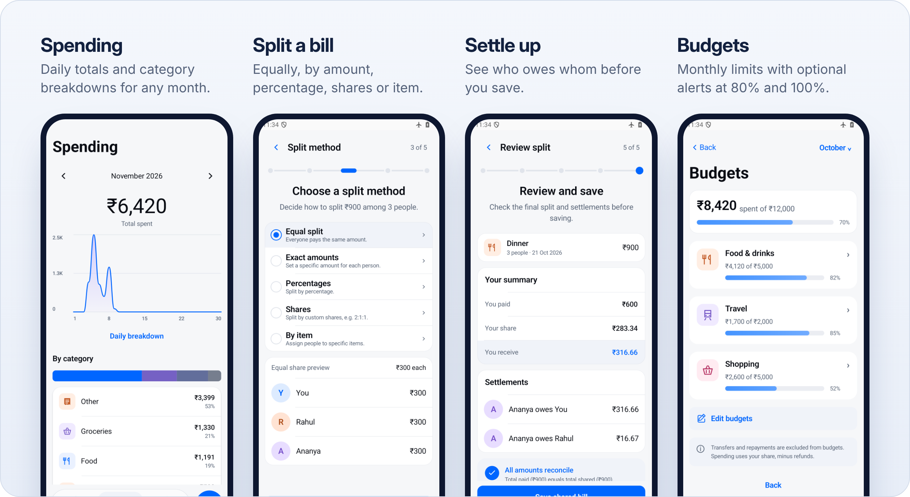

<a href="https://github.com/zack005-design/Tally/releases/latest"></a>

<h3 align="center">Every rupee, accounted for. Offline, private and on your phone.</h3>

<p align="center">
  <a href="https://github.com/zack005-design/Tally/releases/latest"></a>
  <a href="https://github.com/zack005-design/Tally/actions/workflows/android.yml"></a>
  
  
  
</p>

<p align="center">
  <a href="https://github.com/zack005-design/Tally/releases/latest"></a>
</p>

<p align="center">
  <a href="#highlights">Highlights</a>&nbsp;&nbsp;·&nbsp;&nbsp;<a href="#features">Features</a>&nbsp;&nbsp;·&nbsp;&nbsp;<a href="#privacy">Privacy</a>&nbsp;&nbsp;·&nbsp;&nbsp;<a href="#download">Download</a>&nbsp;&nbsp;·&nbsp;&nbsp;<a href="#build-from-source">Build</a>&nbsp;&nbsp;·&nbsp;&nbsp;<a href="docs/README.md">Guides</a>
</p>

<br>

Tally is a personal finance app for Android that works entirely offline. Record spending across your accounts, split shared bills fairly and turn paper or PDF receipts into itemised records. There's no sign-up, no bank connection and no internet permission, so your data never leaves your phone.



## Highlights

<table>
  <tr>
    <td width="33%" valign="top"><b>Truly offline</b><br>No account, no cloud and no internet permission. Receipt reading and suggestions run on the device.</td>
    <td width="33%" valign="top"><b>Fair splits</b><br>What you paid is kept apart from what you spent, so lending money never inflates your spending.</td>
    <td width="33%" valign="top"><b>Fast entry</b><br>Type <code>coffee 80 cash</code>, reuse a favourite or tap the widget. You confirm every entry.</td>
  </tr>
  <tr>
    <td valign="top"><b>Light and dark</b><br>Follows your phone's theme by default, or pick one under <b>Settings → Appearance</b>.</td>
    <td valign="top"><b>Any screen</b><br>A side navigation rail in landscape, and layouts that hold up with large text.</td>
    <td valign="top"><b>Your data, portable</b><br>CSV and PDF reports, plus password-encrypted backups you can restore on any phone.</td>
  </tr>
</table>

## Features

| | Feature | What you can do |
| --- | --- | --- |
| 💳 | [Accounts and transactions](docs/features/everyday-money.md) | Track bank, cash, GPay and more. Record expenses, income, refunds and transfers, reconcile balances and add your own tags. |
| 🤝 | [Shared bills](docs/features/shared-bills.md) | Split equally or by amount, percentage, shares or item, with several payers, partial repayments and running balances per friend. |
| 🧾 | [Receipts](docs/features/receipts.md) | Scan a photo or PDF, check the recognised items and share an itemised receipt PDF with the original scan attached. |
| 📊 | [Spending and planning](docs/features/spending-and-planning.md) | Daily and category views, a yearly summary, budgets with alerts, allowances, recurring drafts and savings goals. |
| ⚡ | [Quick entry](docs/features/quick-entry.md) | Short text commands, recent repeats, favourites and a home-screen widget. |
| 🧠 | [On-device suggestions](docs/features/on-device-ai.md) | In the AI edition, a small local model turns short commands into editable drafts. It never saves anything by itself. |
| 📤 | [Reports and backups](docs/features/reports-and-backups.md) | Monthly CSV or PDF reports and encrypted backups. |
| 🎨 | [Appearance](docs/features/appearance.md) | Light, dark or system theme. Shared receipts and reports always print on a white page. |
| 🧮 | [Calculator](docs/features/calculator.md) | Splits, tax, tips, interest, statistics and conversions, kept apart from your records. |

## Shared bills, done fairly


Your share counts as spending, and what friends owe you stays a balance. Repayments never look like income, and transfers between your own accounts are never counted as spending.

## Privacy

| Protection | How it works |
| --- | --- |
| **Offline by design** | The app has no internet permission. Everything runs on the device. |
| **No bank access** | Tally never reads your bank, payment apps, SMS or card details. |
| **App lock** | Optionally lock Tally with your device PIN, pattern, password or biometrics. |
| **Encrypted backups** | Backups are protected by your password, and Android cloud backup is turned off. |
| **You choose what to share** | Exports happen only when you ask. Shared receipts leave out private notes and balances. |

Read more in the [privacy guide](docs/features/privacy.md).

## Download

The current version is **0.2.4**, for Android 8.0 and later. Both editions have the same finance and receipt features.

| Edition | Quick entry | APK |
| --- | --- | --- |
| **AI** | A local model suggests drafts, with rules as a fallback | [tally-0.2.4-ai-debug.apk](https://github.com/zack005-design/Tally/releases/download/v0.2.4-20261115/tally-0.2.4-ai-debug.apk) |
| **Non-AI** | Rule-based parsing only | [tally-0.2.4-non-ai-debug.apk](https://github.com/zack005-design/Tally/releases/download/v0.2.4-20261115/tally-0.2.4-non-ai-debug.apk) |

Both editions share one app ID, so you can switch between them without losing data. Make an encrypted backup before updating. Follow the [installation guide](docs/getting-started.md) for step-by-step instructions.

> [!NOTE]
> Tally is in active development. These APKs are debug-signed test builds and aren't on the Play Store. The dark theme and adaptive navigation are on `main` and will ship in the next release.

## Build from source

Kotlin, Jetpack Compose, Room and Hilt, targeting Android 17 (API 37).

```bash
./gradlew :app:assembleDebug                      # AI edition
./gradlew :app:assembleDebug -PtallyAi=false      # Non-AI edition
./gradlew :app:testDebugUnitTest :app:lintDebug   # Unit tests and lint
```

## Documentation

[Installation guide](docs/getting-started.md)&nbsp;&nbsp;·&nbsp;&nbsp;[User guides](docs/README.md)&nbsp;&nbsp;·&nbsp;&nbsp;[Screen gallery](docs/screenshots/all-screens/README.md)&nbsp;&nbsp;·&nbsp;&nbsp;[Changelog](CHANGELOG.md)&nbsp;&nbsp;·&nbsp;&nbsp;[Contributing](CONTRIBUTING.md)&nbsp;&nbsp;·&nbsp;&nbsp;[Report an issue](https://github.com/zack005-design/Tally/issues/new/choose)
