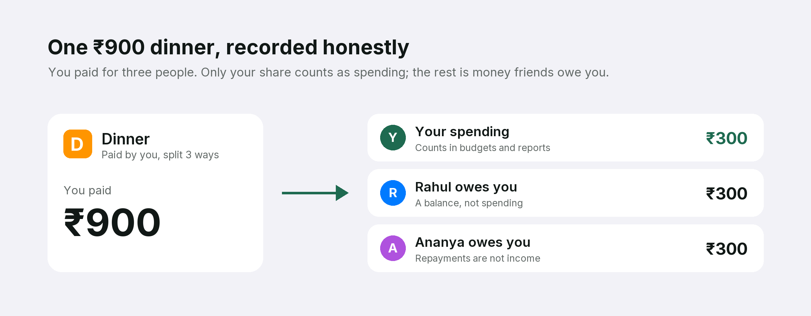

<a href="https://github.com/zack005-design/Tally/releases/latest"></a>

<h3 align="center">A private expense tracker and bill splitter for Android.<br>Everything stays on your phone.</h3>

<p align="center">
  <a href="https://github.com/zack005-design/Tally/releases/latest"></a>
  <a href="https://github.com/zack005-design/Tally/actions/workflows/android.yml"></a>
  
  
  
  <a href="LICENSE"></a>
</p>

<p align="center">
  <a href="https://github.com/zack005-design/Tally/releases/latest"></a>
</p>

<p align="center">
  <a href="#why-tally">Why Tally</a>&nbsp;&nbsp;&middot;&nbsp;&nbsp;<a href="#features">Features</a>&nbsp;&nbsp;&middot;&nbsp;&nbsp;<a href="#privacy">Privacy</a>&nbsp;&nbsp;&middot;&nbsp;&nbsp;<a href="#download">Download</a>&nbsp;&nbsp;&middot;&nbsp;&nbsp;<a href="#get-started">Get started</a>&nbsp;&nbsp;&middot;&nbsp;&nbsp;<a href="#build-from-source">Build</a>&nbsp;&nbsp;&middot;&nbsp;&nbsp;<a href="docs/README.md">Guides</a>
</p>

<br>


## Why Tally

Most finance apps want a login, a bank connection or your data in their cloud. Tally needs none of them. It records spending across your accounts, splits shared bills fairly and turns paper or PDF receipts into itemised records, entirely on the device.

<table>
  <tr>
    <td width="33%" valign="top">
      <b>Private by design</b><br>
      No account, no cloud and no internet permission. Receipt reading and suggestions run on the phone.
    </td>
    <td width="33%" valign="top">
      <b>Shared bills done right</b><br>
      What you paid is kept apart from what you spent, so covering friends never inflates your totals.
    </td>
    <td width="33%" valign="top">
      <b>Seconds to record</b><br>
      Add an expense from Summary, a short command like <code>coffee 80 cash</code>, a favourite or the home-screen widget.
    </td>
  </tr>
</table>

## Features

<table>
  <tr>
    <td width="50%" valign="top">
      <h4><a href="docs/features/everyday-money.md">Accounts and transactions</a></h4>
      Balances for bank accounts, cash, GPay and more. Expenses, income, refunds and transfers, balance checks, tags, and search by text or amount.
    </td>
    <td width="50%" valign="top">
      <h4><a href="docs/features/shared-bills.md">Shared bills</a></h4>
      Split equally or by amount, percentage, shares or item. Several payers, partial repayments and a running balance with each friend.
    </td>
  </tr>
  <tr>
    <td valign="top">
      <h4><a href="docs/features/receipts.md">Receipts</a></h4>
      Scan a photo or PDF, check the recognised items and save. Share a complete itemised receipt PDF with the original scan attached.
    </td>
    <td valign="top">
      <h4><a href="docs/features/spending-and-planning.md">Spending and planning</a></h4>
      A daily limit, category and calendar views, a yearly summary, monthly budgets with alerts, allowances, recurring drafts and savings goals.
    </td>
  </tr>
  <tr>
    <td valign="top">
      <h4><a href="docs/features/quick-entry.md">Quick entry</a></h4>
      Short text commands, recent purchases, favourites and a home-screen widget. Every entry is confirmed before it is saved.
    </td>
    <td valign="top">
      <h4><a href="docs/features/on-device-ai.md">On-device suggestions</a></h4>
      In the AI edition, a small model on your phone turns short commands into editable drafts. It never saves anything by itself.
    </td>
  </tr>
  <tr>
    <td valign="top">
      <h4><a href="docs/features/reports-and-backups.md">Reports and backups</a></h4>
      CSV and PDF reports with accounts and tags, and password-encrypted backups you can restore on any phone.
    </td>
    <td valign="top">
      <h4><a href="docs/features/calculator.md">Calculator</a></h4>
      Splits, tax, tips, interest, statistics and unit conversions, kept separate from your records.
    </td>
  </tr>
</table>

### Shared bills, recorded correctly



Your share counts as spending and the rest becomes a balance with each friend. Repayments are never treated as income, and transfers between your own accounts are never counted as spending.

### Light, dark and every screen size


- **Themes.** Tally follows your phone's theme, or choose Light or Dark under **Settings &rarr; Appearance**. See the [appearance guide](docs/features/appearance.md).
- **Familiar layout.** Grouped lists, clear type and a floating tab bar for Summary, Activity, Spending and Split, with search one tap away.
- **Adaptive.** Narrow phones scale so nothing is cut off, landscape screens use a side rail, and large text keeps controls on one row where they fit. See [phone compatibility](docs/phone-compatibility.md).

## Privacy

### What Tally does and does not do

| | Tally |
| --- | :---: |
| Works fully offline | Yes |
| Needs an account or sign-in | No |
| Connects to your bank, cards or payment apps | No |
| Reads your SMS messages | No |
| Sends analytics or usage data | No |
| Stores records in Android cloud backup | No, turned off |
| Encrypts backups you export | Yes, with your password |

### Permissions

| Permission | Why Tally asks for it |
| --- | --- |
| Biometrics | Optional app lock with your fingerprint, face or device PIN. |
| Notifications | Optional reminders and budget alerts. |
| Run at startup | Restores scheduled reminders after the phone restarts. |
| Internet | **Not requested.** The build removes it, and every release is checked for it. |

Reports and receipts leave the phone only when you share them, and shared receipts leave out private notes and account balances. More detail is in the [privacy guide](docs/features/privacy.md).

## Download

The latest version is **0.2.5**, the iOS-style redesign, for Android 8.0 and later. Pick **one** edition; both have the same finance and receipt features.

| Edition | Best for | Download |
| --- | --- | --- |
| **AI** | Typing short commands that a small on-device model turns into drafts | [tally-0.2.5-ai-debug.apk](https://github.com/zack005-design/Tally/releases/download/v0.2.5-20261123/tally-0.2.5-ai-debug.apk) |
| **Non-AI** | Rule-based parsing and a smaller download | [tally-0.2.5-non-ai-debug.apk](https://github.com/zack005-design/Tally/releases/download/v0.2.5-20261123/tally-0.2.5-non-ai-debug.apk) |

The editions share one app ID, so you can switch later without losing data. Checksums, release notes and earlier versions are on the [releases page](https://github.com/zack005-design/Tally/releases).

> [!IMPORTANT]
> Export an encrypted backup before every update, and install the new APK over the old one. Never uninstall to update: uninstalling deletes your records.

> [!NOTE]
> These are development builds signed with a test key, not Play Store releases. The redesign has passed automated tests on Android 8, 15, 16 and 17 emulators but has not yet been checked on a physical phone.

## Get started

| You are | Start here |
| --- | --- |
| **New to Tally** | Follow the [installation guide](docs/getting-started.md), then set your starting balances. |
| **Updating from 0.2.4 or earlier** | Read the [0.2.5 release notes](docs/releases/0.2.5.md), export a backup, then install over your current version. |
| **Switching editions** | See [downloads](docs/downloads.md); both editions read the same data. |
| **Bringing spending from a chat** | Use [chat history import](docs/features/chat-history-import.md) with the Tally Companion plugin. |

## What's next

The next release is taking shape on `main`: a blue app tint, a new first-launch walkthrough, and better fits for the narrowest phones and landscape camera cutouts. See **Unreleased** in the [changelog](CHANGELOG.md).

## Build from source

Tally is a native Android app.

| Area | Choice |
| --- | --- |
| Language and UI | Kotlin, Jetpack Compose |
| Storage | Room, exact integer-paise arithmetic |
| Dependency injection | Hilt |
| Target | Android 17 (API 37), minimum Android 8.0 (API 26) |
| Checks | Unit tests, Android lint and emulator tests on every push to `main` |

```bash
./gradlew :app:assembleDebug                      # AI edition
./gradlew :app:assembleDebug -PtallyAi=false      # Non-AI edition
./gradlew :app:testDebugUnitTest :app:lintDebug   # Unit tests and lint
```

The [project structure](docs/project.md) explains how the code is organised, and [Build a signed release](docs/release-signing.md) covers signing and publishing.

## Documentation

| Guide | Description |
| --- | --- |
| [Installation guide](docs/getting-started.md) | Install, update and switch editions safely |
| [User guides](docs/README.md) | Every feature, step by step |
| [Screen gallery](docs/screenshots/all-screens/README.md) | Captures of every screen |
| [Changelog](CHANGELOG.md) | What changed in each release |
| [Contributing](CONTRIBUTING.md) | How to propose and test changes |
| [Security policy](SECURITY.md) | How to report a vulnerability privately |

Found a problem? [Report an issue](https://github.com/zack005-design/Tally/issues/new/choose).

## License

Tally is released under the [MIT License](LICENSE). The Inter typeface is used under the [SIL Open Font License](docs/licenses/Inter-OFL.txt).
