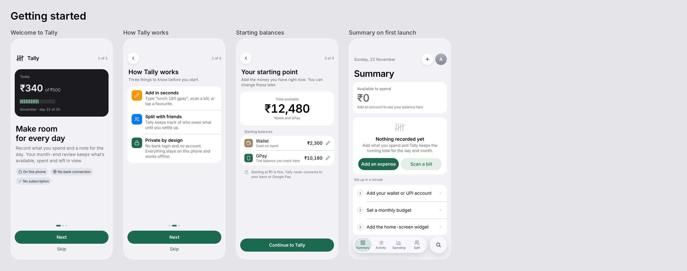
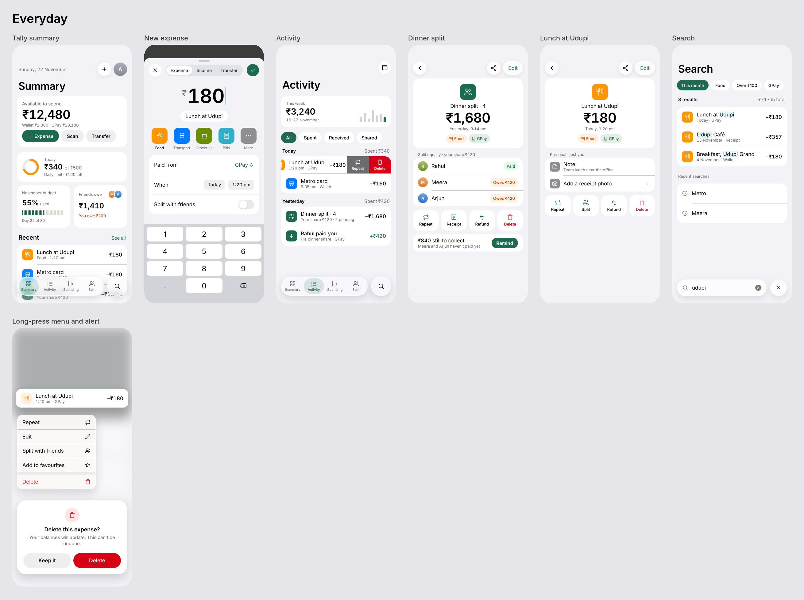
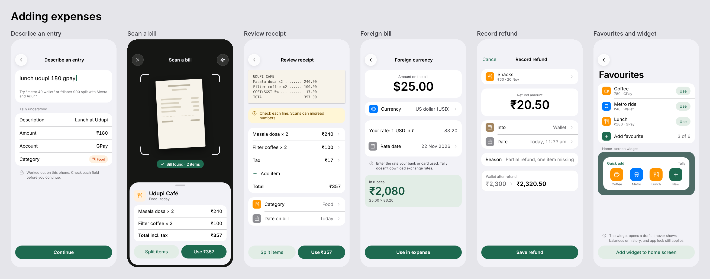
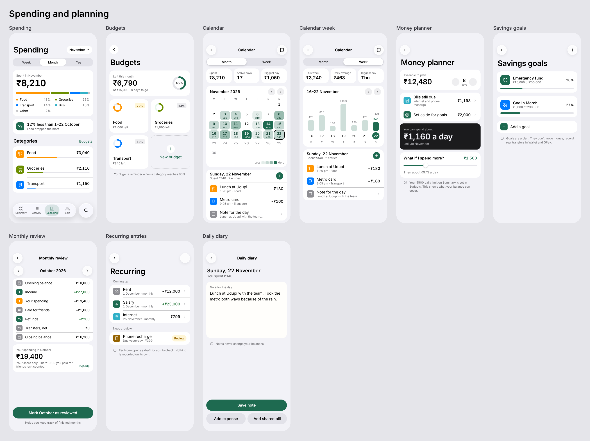
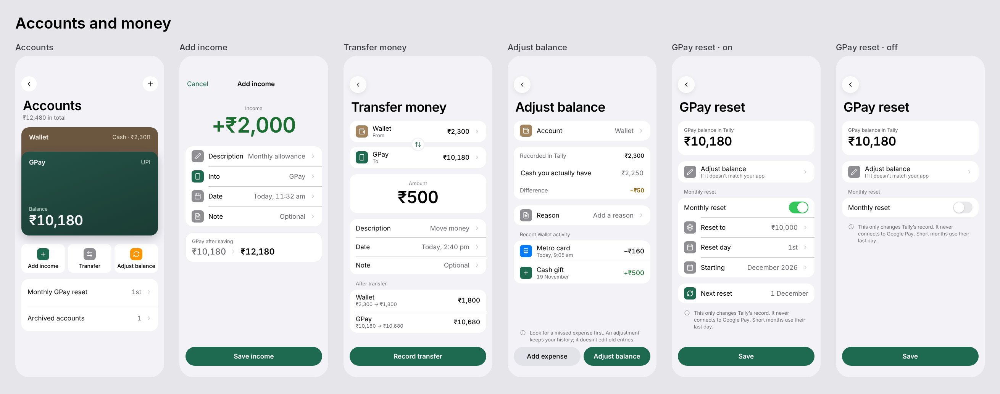
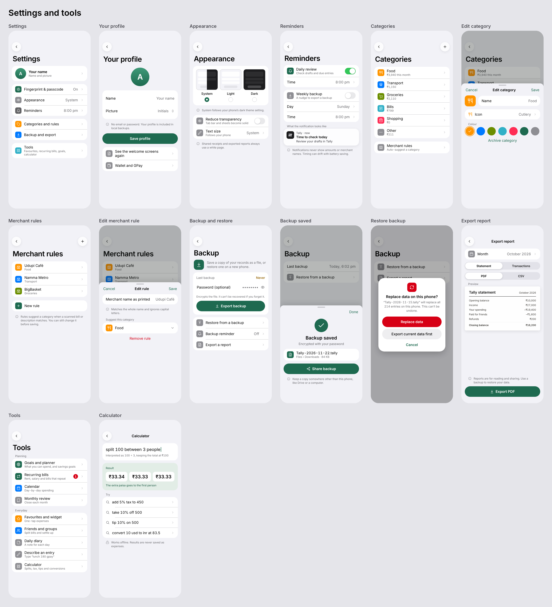
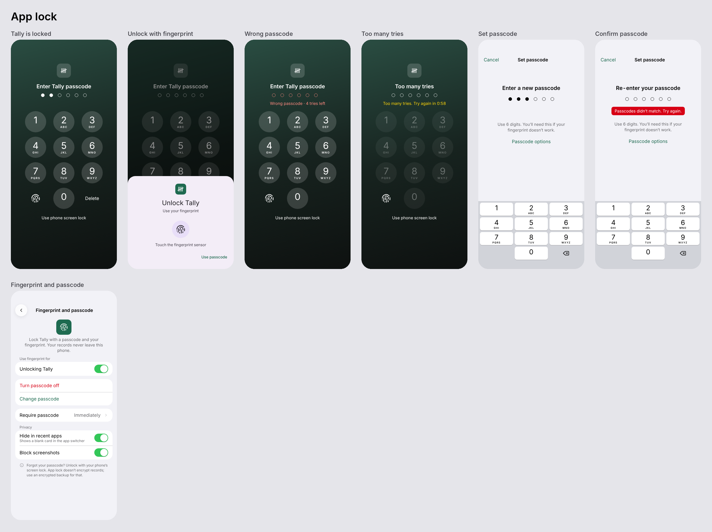
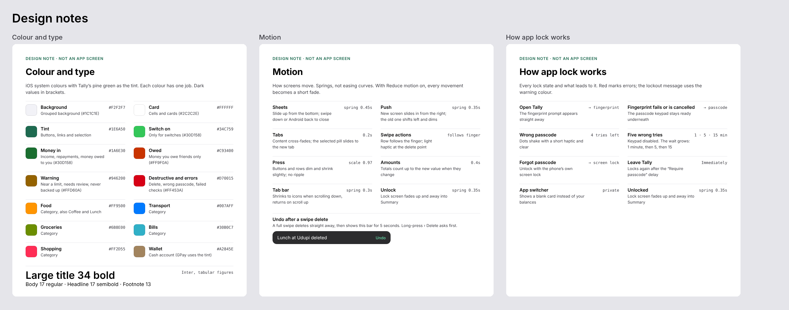
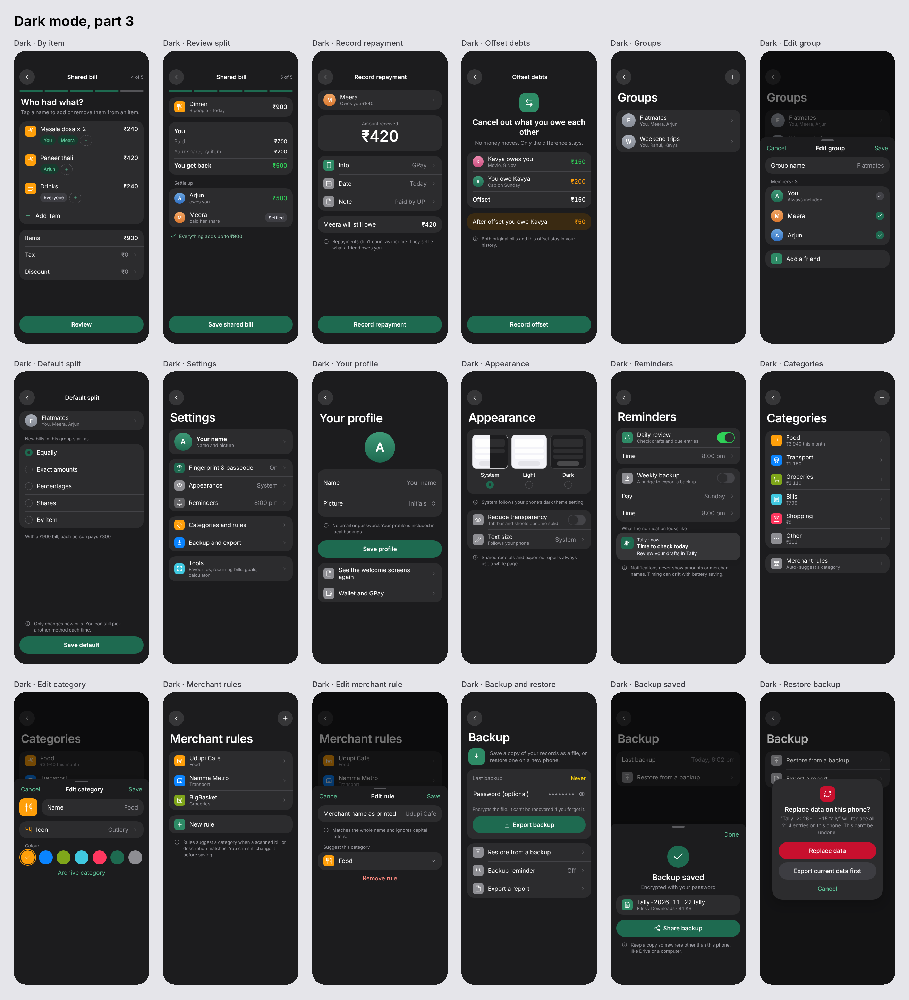
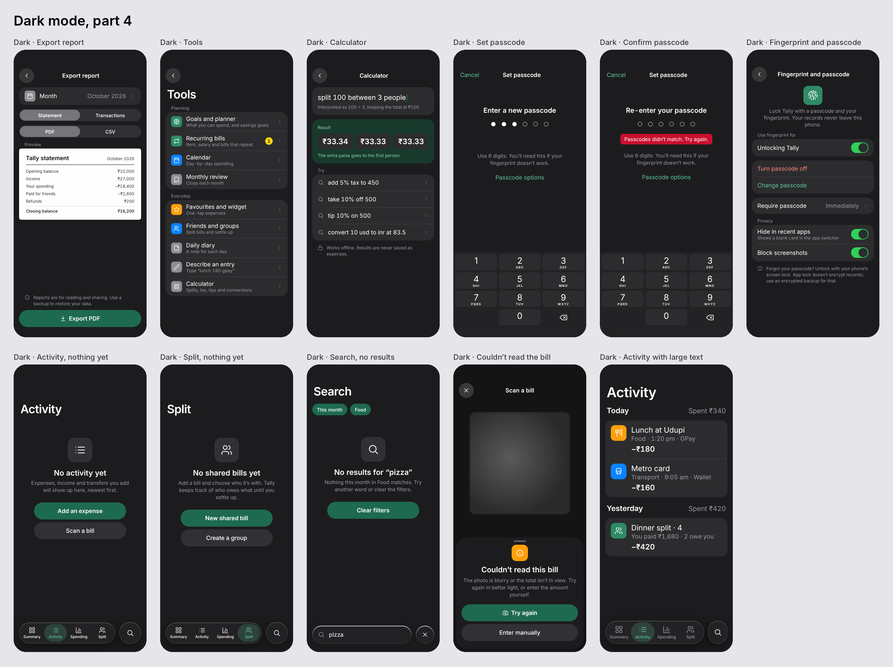

[← Back to guides](../README.md)

# iOS-style redesign preview

A design preview of Tally with an iOS look, built for the Android app. It covers every screen in the current app, plus a new app lock, error and empty states, and dark mode. This is a design proposal only: the app itself has not changed.

**Status:** preview, not yet built. Nothing here has been checked on a real phone.

**Size:** 74 app screens, 65 of them with a dark version, plus 3 design notes. The 9 screens without a dark version are either drawn by Android itself (permission dialog, share sheet, notification, home screen) or already dark (camera and lock screens).

## Download

[Full redesign (PDF, 58 pages, 5.7 MB)](tally-redesign.pdf): cover with contents, Android behaviour rules, every app screen, the design notes, then the dark version of every screen that has one (from page 34).

## Overview

| | |
| --- | --- |
|  |  |
|  |  |
|  |  |
|  |  |
|  |  |
|  |  |
|  |  |

## Design direction

- **iOS system look:** light grey background (#F2F2F7), white inset grouped lists, bold large titles, solid colour icon squares, contact-style avatars with a colour per person, and rounded capsule buttons.
- **One job per colour:**
  - Blue (#0A66D8) is the app tint: buttons, links and selection. It replaced the earlier pine green.
  - Green (#1A6E30) is money coming in; switches use the iOS switch green (#34C759).
  - Orange (#C93400) is money you owe friends, and nothing else.
  - Ochre (#946200) is for warnings: near a limit, needs review, never backed up.
  - Red (#D70015) is for deleting and errors.
- **Categories:** Food orange, Transport blue, Groceries olive, Bills teal, Shopping pink. The Wallet account is brown.
- **Glass tab bar:** a floating, translucent tab bar and search button, as in iOS. On Android 11 and older, or with "Reduce transparency" on, they become solid.
- **Dark mode:** iOS dark greys (#1C1C1E background, #2C2C2E cards) rather than pure black. Tinted icon tiles and buttons use a dark navy (#0F2A4A), and the tint brightens to #0A84FF.
- **Type and icons:** Inter and Lucide, because Apple's SF Pro and SF Symbols are licensed for Apple platforms only.

## How the flows fit together

- **Adding an expense:** the New expense keypad sheet is the main path. Describe an entry and a scanned bill both fill in that same sheet. Turning on "Split with friends" opens the five-step shared bill.
- **Money in:** "Add income" covers salary, allowances and any other money you receive. Transfers move money between your own accounts. "Adjust balance" corrects a balance that doesn't match.
- **Shared bills:** every list and total counts your share. A bill you paid for shows −₹420 (your share), with "You paid ₹1,680" underneath. The bill's detail screen shows the full amount and each person, including you.
- **Daily limit:** the ₹500 a day on Summary is a budget you set. The money planner shows what your balance could cover, about ₹1,160 a day. Rent of ₹12,000 on 1 December is paid from that day's salary, not from this balance.
- **App lock:** a new 6-digit passcode with fingerprint unlock. The phone's own screen lock always works as a fallback. The current app uses the phone's screen lock only.

## Example data

All screens share one example: Sunday 22 November 2026, 6:15 pm. November spending is ₹8,210; the calendar days, the category list and the spending chart all add up to that total. October's review, the recurring entries and the money planner use the same figures.

## Not covered yet

- Small phones (360 dp), tablets and foldables.
- Checking on a real Android phone.
