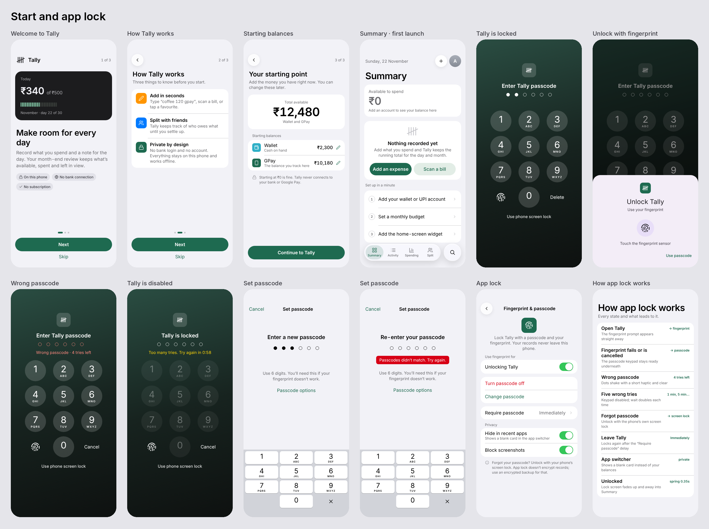
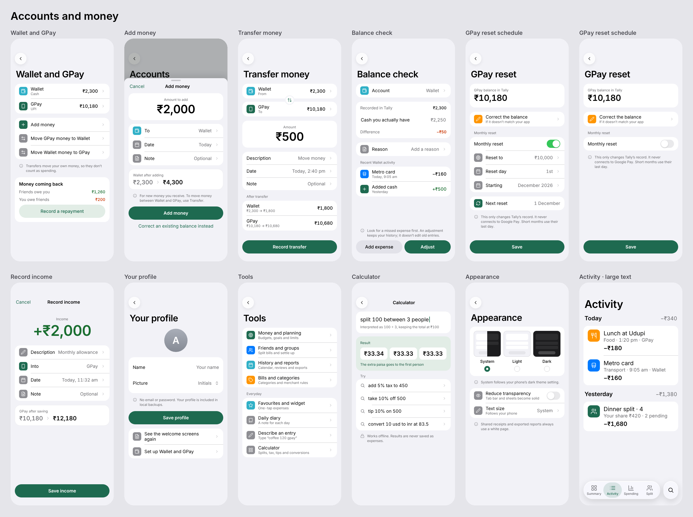
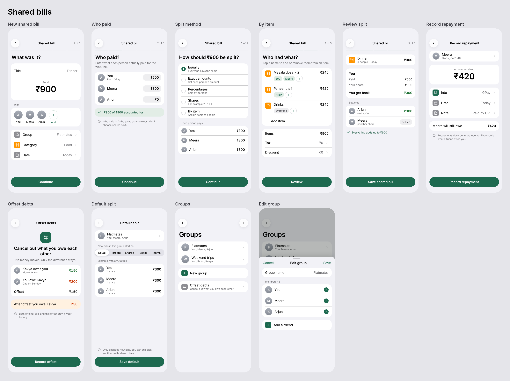
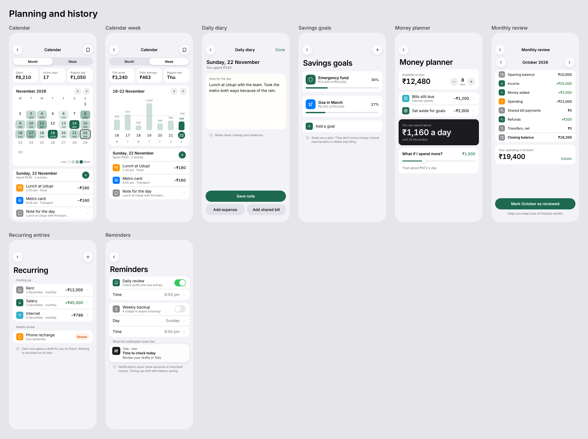
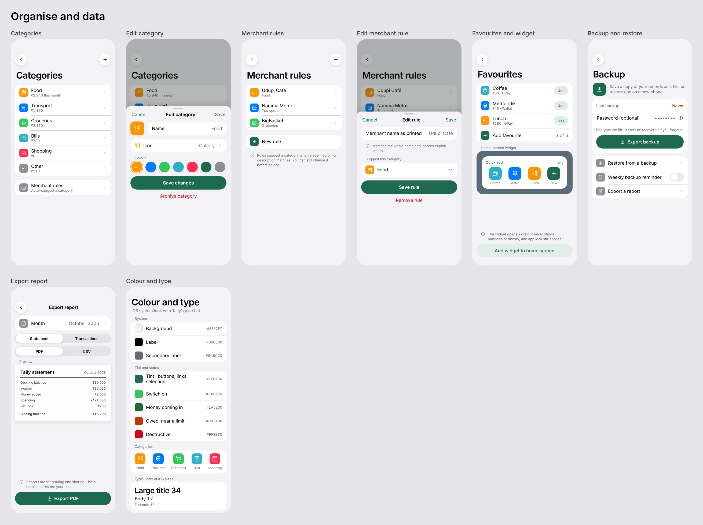
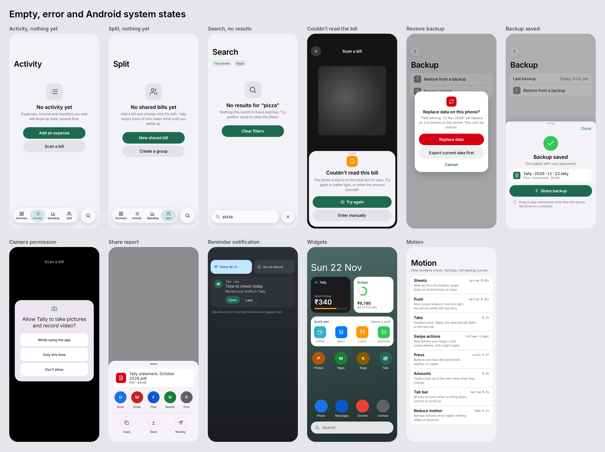
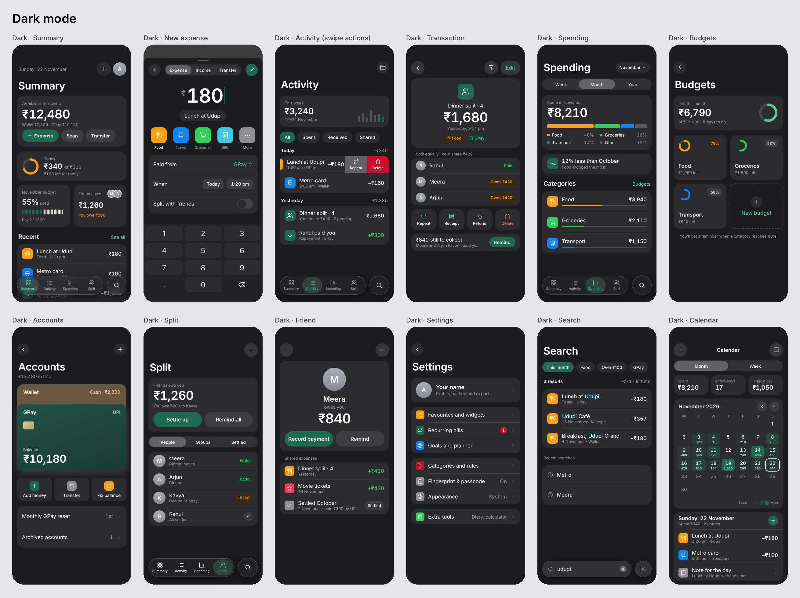
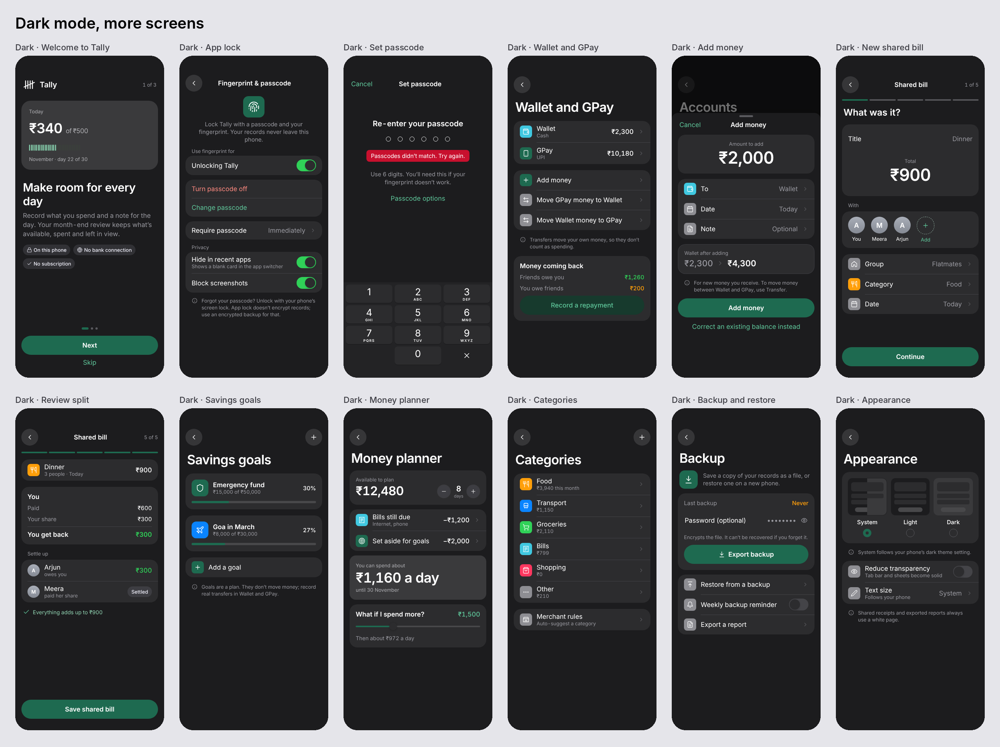

[← Back to guides](../README.md)

# iOS-style redesign preview

A design preview of Tally with an iOS look, built for the Android app. It covers every screen in the current app, plus a new app lock, error and empty states, and dark mode. This is a design proposal only: the app itself has not changed.

**Status:** preview, not yet built. Nothing here has been checked on a real phone.

## Download

- [Light screens (PDF, 36 pages)](tally-redesign-light.pdf): cover, Android behaviour rules, all light screens, Android system moments and motion notes.
- [Dark screens (PDF, 29 pages)](tally-redesign-dark.pdf): the dark version of every app screen.

## Overview

| | |
| --- | --- |
|  |  |
|  |  |
|  |  |
|  |  |
|  |  |

## Design direction

- **iOS system look:** light grey background (#F2F2F7), white inset grouped lists, bold large titles, solid colour icon squares, contact-style avatars, green switches and rounded capsule buttons.
- **App tint:** Tally's pine green (#1E6A50) for buttons, links and selection. Money coming in is green, money owed is amber, and red is for deleting only.
- **Glass tab bar:** a floating, translucent tab bar and search button, as in iOS. On Android 11 and older, or with "Reduce transparency" on, they become solid.
- **Dark mode:** iOS dark greys (#1C1C1E background, #2C2C2E cards) rather than pure black.
- **Type and icons:** Inter and Lucide, because Apple's SF Pro and SF Symbols are licensed for Apple platforms only.

## What's included

- **Every screen in the app:** 69 light screens, each with a dark version, using the same example data throughout so the numbers add up.
- **App lock:** an iOS-style passcode screen with fingerprint unlock, wrong-passcode and too-many-tries states, passcode setup and confirmation, settings, and a page describing each state.
- **Errors and empty states:** no activity, no shared bills, no search results, a bill that couldn't be read, confirming a restore, and a saved backup.
- **Android system moments:** the fingerprint prompt, camera permission, share sheet, notification and home-screen widget stay native Android, as both Google and Apple recommend.
- **Motion notes:** how sheets, screen changes, tabs, swipes and presses should move, with a reduce-motion fallback.

## Not covered yet

- Small phones (360 dp), tablets and foldables.
- A separate app passcode is new: the current app uses the phone's own screen lock. The design keeps the phone's screen lock as the fallback.
