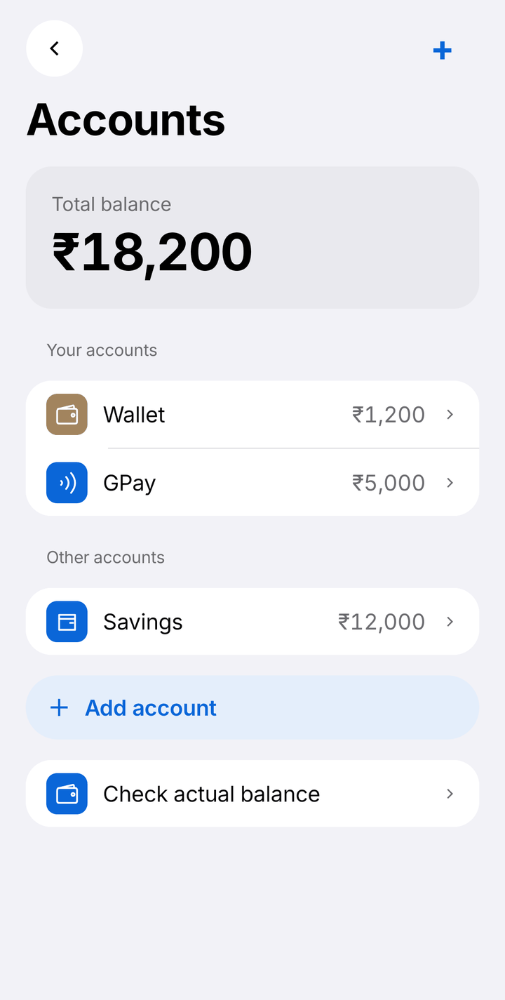

[← Back to features](../../README.md#features)

# Everyday money

Keep a clear record of what you have, what you spend, and how money moves between your accounts. Tally supports balances you maintain yourself, including Wallet and GPay.

## What you can do

- Record expenses against an account and category.
- Record income, add funds, and track personal refunds.
- Transfer money between your own accounts.
- Compare recorded balances with your actual balances and reconcile differences.
- Review recent activity and open transaction details.

## A typical day

1. Set up the accounts you use and their starting balances.
2. Record a purchase with its amount, date, category, and payment account.
3. When moving cash between accounts, record a transfer.
4. Check your account balances against your cash or payment app and use balance reconciliation when needed.

## Tag transactions

Tags are your own labels, such as `Goa trip` or `work`, that group transactions across categories.

1. Open a saved transaction.
2. Tap **Tags** and type one or more tags separated by commas. Tags you have used before appear as shortcuts.
3. Tap **Save**. Leave the box empty and save to remove all tags.

Each transaction can have up to 10 tags of up to 30 characters. A leading `#` is optional, and `Goa Trip` and `goa trip` count as the same tag.

In **Activity**, tap a tag above the list to show only those transactions, or search for a tag by name. The [yearly summary](spending-and-planning.md#yearly-summary) totals your spending for each tag.

Tags never change amounts, balances or budgets. They are kept when you edit a transaction and are included in encrypted backups. A backup that contains tags cannot be restored by Tally 0.2.4 or earlier.

## How the accounting works

A ₹500 transfer from GPay to Wallet changes the two account balances without creating income or spending. An expense reduces the selected account; a personal refund records money returned for a purchase.

Wallet and GPay are manually maintained accounts. Tally does not connect to your bank or read Google Pay transactions automatically.

[View account screen](../screenshots/all-screens/accounts.png) · [Shared bills and repayments →](shared-bills.md)
