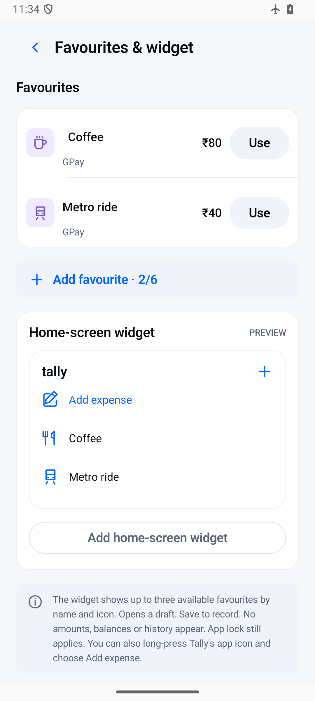

[← Back to features](../../README.md#features)

# Quicker daily entry

Spend less time entering purchases you make regularly. Save favourite expense templates, repeat recent purchases, and open entry from your Android home screen.

## Reuse a favourite

1. Create a favourite with the details you commonly use.
2. Choose **Use** to start an expense from that template.
3. Review the amount, account, category, and date for this purchase.
4. Confirm the entry before saving.

You can edit or remove favourite templates as your routine changes. Check the account and category when reusing an older template.

## Start from your home screen

Use **Add home-screen widget** from the favourites screen when your launcher supports pinning widgets. The widget and launcher shortcut provide a quicker route to expense entry.

You can also repeat a recent purchase instead of entering its details again. These shortcuts prepare an entry for review; opening a shortcut does not itself save a purchase.

## Example

Save your usual coffee as a favourite. On the next visit, use the template, adjust the price if it changed, check the payment account, and confirm. Each visit remains a separate transaction.

[View favourites](../screenshots/all-screens/favourites.png) · [Everyday money →](everyday-money.md)
