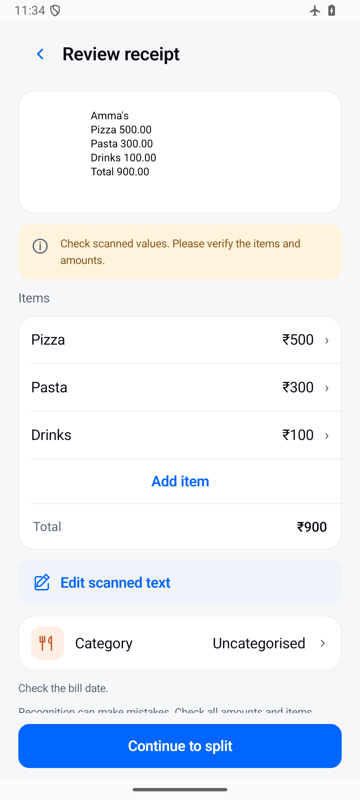

[← Back to features](../../README.md#features)

# Receipts, without retyping

Bring a receipt photo or PDF into Tally and review the recognized text before recording the expense. Receipt recognition runs on your device using a bundled model.

## From receipt to record

1. Import a receipt photo or PDF.
2. Review the recognized items and amounts.
3. Correct missing or misread details, checking the total against the original receipt.
4. Confirm the payment details and save after reviewing the entry.

In current source builds, use **Enlarge receipt** to inspect the original in a full-screen preview. Pinch to zoom and drag, or use **Zoom in**, **Zoom out**, and **Reset zoom**. PDF page controls are available there too. Screen readers also have actions to move around the enlarged image.

Use **Replace receipt** to retake the photo or choose another image or PDF. The current receipt and its corrections remain available if you cancel or the replacement cannot be read. A successful replacement clears the old item corrections and category selection so you can review the new bill.

Imports support up to 5 PDF pages, a 6 MB source file, and 10,000 recognized text characters. If recognition exceeds the text limit, Tally rejects the import with an explanation instead of silently dropping the end. Import a smaller receipt section or enter the expense manually. The original source file is not modified.

## What to check

Receipt layouts, faint printing, and image quality can affect recognition. Pay particular attention to decimal places, quantities, discounts, taxes, and the final amount. The review step gives you a chance to correct the draft before it becomes a record.

For photos, Tally uses recognised text positions to join item names and prices across separate columns. It reads long receipts in overlapping sections and preserves more small-print detail, including photos carrying camera rotation metadata, while keeping image memory bounded. The receipt parser recognises adjacent item/price lines and quantity/rate/amount tables. It prefers a printed grand total or payable amount over a pre-tax total, excludes tax and payment summary rows from the item list, and flags possible missing items when their sum differs from the printed subtotal. Conflicting payable totals still need manual review. Items are bounded by the scanned-text limit rather than silently stopping at 50 rows.

Recognition helps with entry; you remain responsible for confirming the bill details. Tally has no Internet permission, so receipt recognition does not upload your receipt to a cloud service.

Tables headed “Amt” are supported alongside “Amount”. Year-first dates such as `2026-02-06` are recognised, and a separate “Paid Amount” is kept out of the purchase list. Check item spelling against the photo; recognition can still misread individual letters.

Merchant suggestions skip common tax-registration, invoice, and contact headers, and do not use purchase rows or footer text as the shop name. Check the suggested name before saving; receipt headers can still be ambiguous.

Camera photos with faint print or uneven lighting can receive an automatic contrast-recovery pass. Tally compares it with the original OCR result and shows a warning when recovered text needs checking. The original photo stays unchanged, and the warning follows the draft into the split form. Severe blur, glare or missing print can still require a closer, sharper photo or manual correction; the app does not guess unseen purchases or amounts.

Tilted photo columns are aligned using the printed text angle so a price does not drift onto a neighbouring item. Purchase extraction stops at the final printed total; footer numbers such as loyalty points are not purchases, and intermediate subtotals do not discard later pages. Decimal commas in recognised prices retain their paise instead of inflating the amount. Always compare the result with the original, especially when the photo is blurred or has perspective distortion.

## Share a receipt PDF

These sharing options are available in current source builds; the existing 0.2.3 download predates this update.

See the [receipt verification and broader app audit](../testing/2026-11-11-receipts.md) for tested behavior and remaining limits.

The [audit follow-up verification](../testing/2026-11-11-audit-follow-up.md) covers enlarged previews, replacement safety, import text limits, merchant detection, metadata refreshes, and refund recipients.

Open a saved expense and choose **Share receipt PDF** for a formatted expense record showing the total, payments, shares and remaining bill debts. Long receipts continue onto additional pages. Private notes and account balances are excluded. This expense record is not a merchant tax invoice.

When a bill attachment is saved, choose **Share original receipt PDF** to share the actual printed bill: a photo becomes a PDF with its orientation preserved, and an existing PDF keeps its original pages. Long photos span pages without cutting off the bottom. This includes everything visible on the original receipt; OCR text is not substituted for the image.

[View receipt review](../screenshots/all-screens/receipt-review.png) · [Shared bills →](shared-bills.md)
