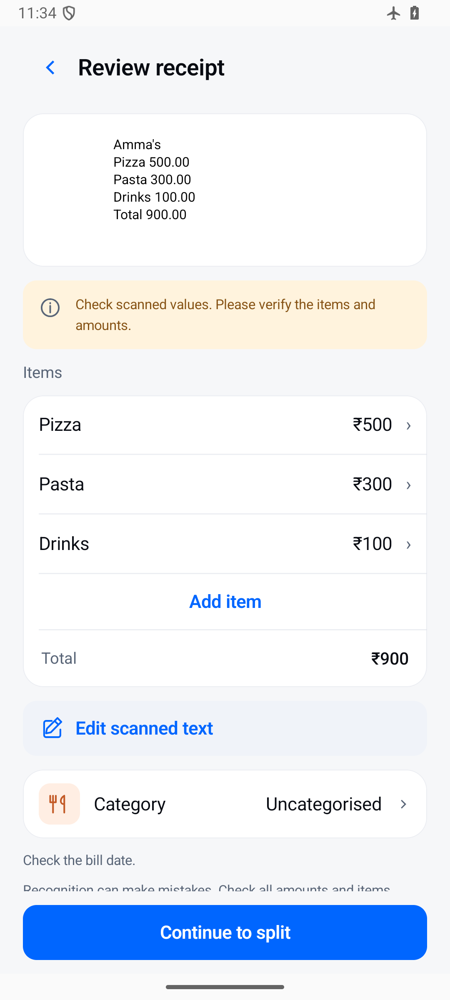

[← Back to features](../../README.md#features)

# Receipts, without retyping

Bring a receipt photo or PDF into Tally and review the recognized text before recording the expense. Receipt recognition runs on your device using a bundled model.

## From receipt to record

1. Import a receipt photo or PDF.
2. Review the recognized items and amounts.
3. Correct missing or misread details, checking the total against the original receipt.
4. Confirm the payment details and save after reviewing the entry.

## What to check

Receipt layouts, faint printing, and image quality can affect recognition. Pay particular attention to decimal places, quantities, discounts, taxes, and the final amount. The review step gives you a chance to correct the draft before it becomes a record.

For photos, Tally uses recognised text positions to join item names and prices across separate columns. It reads long receipts in overlapping sections and preserves more small-print detail, including photos carrying camera rotation metadata, while keeping image memory bounded. The receipt parser recognises adjacent item/price lines and quantity/rate/amount tables. It prefers a printed grand total or payable amount over a pre-tax total, excludes tax and payment summary rows from the item list, and flags possible missing items when their sum differs from the printed subtotal. Conflicting payable totals still need manual review. Items are bounded by the scanned-text limit rather than silently stopping at 50 rows.

Recognition helps with entry; you remain responsible for confirming the bill details. Tally has no Internet permission, so receipt recognition does not upload your receipt to a cloud service.

Tables headed “Amt” are supported alongside “Amount”. Year-first dates such as `2026-02-06` are recognised, and a separate “Paid Amount” is kept out of the purchase list. Check item spelling against the photo; recognition can still misread individual letters.

[View receipt review](../screenshots/all-screens/receipt-review.png) · [Shared bills →](shared-bills.md)
