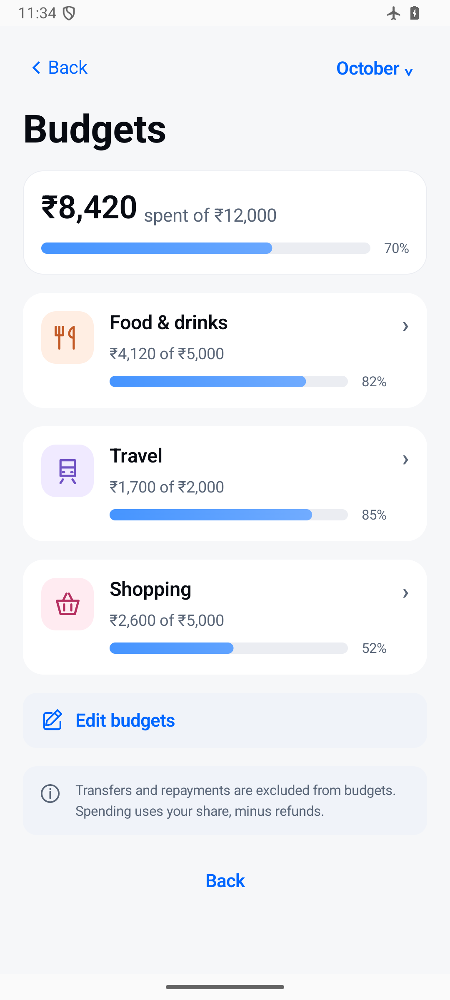

[← Back to features](../../README.md#features)

# Spending and planning

Understand where your money goes and plan the next month with budgets, allowances, recurring drafts, and savings goals.

## Review your spending

Use the calendar to explore transactions by day, then review category totals and monthly activity. Open the transactions behind a total when you need more context.

For shared bills, your personal share is distinct from the cash you paid on behalf of the group. Transfers between your own accounts stay separate from spending.

## Plan ahead

| Tool | Purpose |
| --- | --- |
| Monthly budgets | Set category limits and review recorded spending against them. |
| Allowance planning | Plan how much money to set aside for everyday spending. |
| Recurring drafts | Prepare entries for repeated expenses. |
| Savings goals | Keep savings targets visible alongside your plans. |

## A monthly routine

1. Review the previous month's transactions and category totals.
2. Set budgets that reflect your priorities.
3. Prepare recurring drafts for regular costs.
4. Check progress throughout the month and adjust your plans when needed.

Plans and drafts help you organize records. They do not schedule bank payments or move money automatically.

[View budgets](../screenshots/all-screens/budgets.png) · [View calendar](../screenshots/readme/calendar.png) · [Reports and backups →](reports-and-backups.md)
