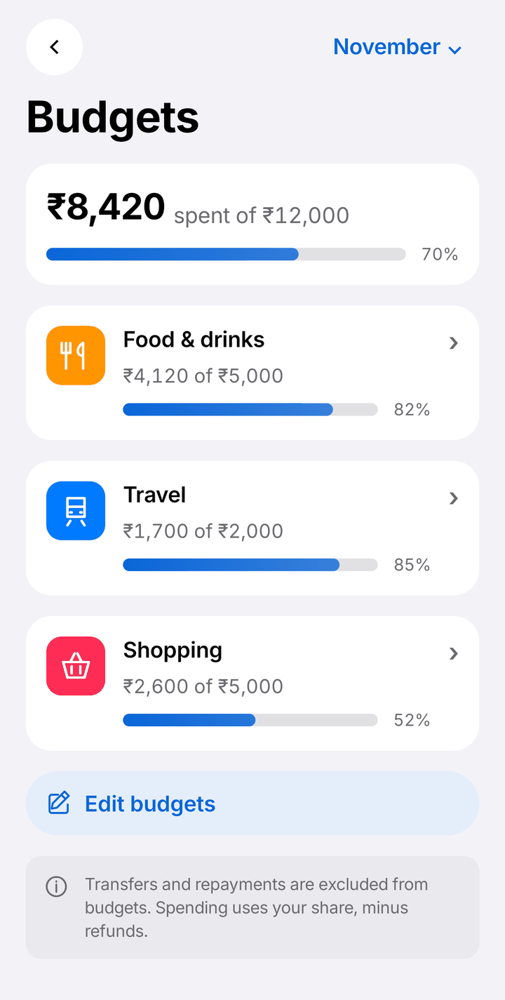

[← Back to features](../../README.md#features)

# Spending and planning

Understand where your money goes and plan the next month with budgets, allowances, recurring drafts, and savings goals.

## Review your spending

Use the calendar to explore transactions by day, then review category totals and monthly activity. Open the transactions behind a total when you need more context.

For shared bills, your personal share is distinct from the cash you paid on behalf of the group. Transfers between your own accounts stay separate from spending.

## Yearly summary

Open **Tools → History & reports → Yearly summary** to see a whole year at once:

- total spending and income for the year
- how spending compares with last year. For the year in progress, Tally compares the same dates, so January to November is measured against January to November last year.
- spending for each month, with the highest month marked
- your top categories and their share of the year
- your spending for each [tag](everyday-money.md#tag-transactions)

Use the arrows to move between years. The summary uses the same rules as monthly reports: only your share of a shared bill counts, refunds reduce spending, and transfers and repayments are not spending. It is built only from the records you entered.

## Plan ahead

| Tool | Purpose |
| --- | --- |
| Monthly budgets | Set category limits and review recorded spending against them. |
| Budget alerts | Optionally get a local notification when this month's spending reaches 80% or 100% of a budget. Turn it on in **Reminders**. |
| Allowance planning | Plan how much money to set aside for everyday spending. |
| Recurring drafts | Prepare entries for repeated expenses. |
| Savings goals | Keep savings targets visible alongside your plans. |

## A monthly routine

1. Review the previous month's transactions and category totals.
2. Set budgets that reflect your priorities.
3. Prepare recurring drafts for regular costs.
4. Check progress throughout the month and adjust your plans when needed.

Plans and drafts help you organize records. They do not schedule bank payments or move money automatically.

[View budgets](../screenshots/all-screens/budgets.png) · [View calendar](../screenshots/readme/calendar.png) · [Reports and backups →](reports-and-backups.md)
